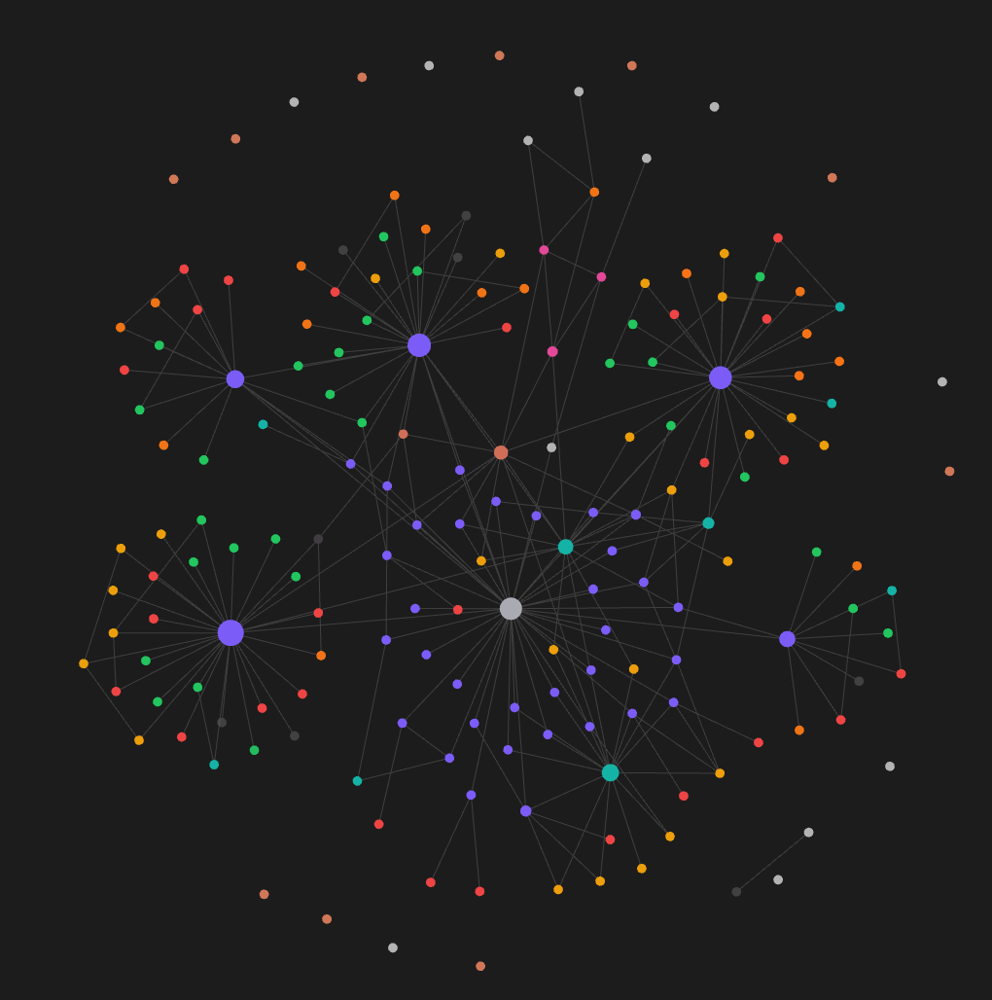
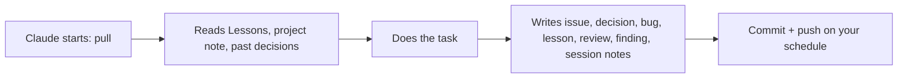

# Claude-Obsidian-Brain

A single prompt that turns [Obsidian](https://obsidian.md) into a long-term memory for [Claude Code](https://code.claude.com). Claude reads the vault before every task and writes to it afterwards: issues, decisions, bugs, lessons, reviews and security findings, all linked to the project they belong to.

*Graph view of a vault in use. Purple hubs are projects; issues, decisions, bugs, lessons, docs, reviews and security findings are linked around them.*

## Quick start

1. Open [`setup-prompt.md`](setup-prompt.md) and copy all of it (the **Raw** view makes that easier).
2. Start Claude Code. On Windows, run it inside WSL. On macOS or Linux, use a normal terminal.
3. Paste the prompt and send it. Claude works through 8 phases and stops whenever it needs you to do something. It takes about 15 minutes.

## What Claude asks you

| Question | Options |
|---|---|
| Where should the vault sync to? | GitHub · GitLab (gitlab.com or self-hosted) · no sync (local git only) |
| How often? | Once a day at a time you choose · every hour · after every single Claude action |
| Who makes the commits? | A bot ("Knowledgebase Bot", pushed with an access token / PAT limited to this one repo, so commits do not count as your activity) · you (your own git identity and login) |
| What may be stored? | Content only (no personal names or emails) · content + personal info (a `Me.md` profile, people by name and role) |
| Save your Claude Code setup too? | Yes: settings, `CLAUDE.md`, commands, agents, hooks, your own skills, and the plugin and MCP server lists go to `Claude/backup/` with secrets redacted, and one script restores them · no |
| Note language | Any language |
| Repo name | `knowledgebase` by default |

Secrets, passwords, tokens and customer data are never stored, whatever you answer. Your answers are saved to `~/.config/kb/config`. To change one later, edit that file and run `bash ~/claude-knowledgebase/setup/install.sh` again.

## What you get

- **A vault with structure**: one folder, template and color per note type (Projects, Issues, Decisions, Bugs, Lessons, Docs, Sessions, Reviews, Security), dashboards built with Obsidian Bases, and a colored graph view.
- **Rules in `~/.claude/CLAUDE.md`** that tell Claude what to read before working and what to write afterwards, without being asked.
- **Sync**: the vault is pulled when Claude Code starts. It is pushed by Windows Task Scheduler, cron or a Claude Code Stop hook, depending on the schedule you chose. If a push fails, you are told at the next start.
- **Security tracking**: every finding gets its own note and is never deleted. Every audit checks all known findings again. Known false positives are flagged again and you are asked to confirm them.
- **Secret scanning** in CI (GitHub Actions with gitleaks, or GitLab Secret Detection). It runs weekly or when started by hand, not on every sync.
- **The [Obsidian skills](https://github.com/kepano/obsidian-skills)** plugin for Claude Code.

## Requirements

- Claude Code
- Windows with WSL2, macOS, or Linux; `git` and `python3`
- Obsidian (the prompt walks you through installing it)
- A GitHub or GitLab account, unless you choose local only

## How the prompt is built

The prompt is self-contained. It includes every template, script and config file of the vault, but none of anyone's notes. It is generated by `setup/build-prompt.py` inside the vault, so the vault you end up with can rebuild the prompt for someone else.
