# Set up my Claude Knowledgebase

You are setting up a personal Obsidian knowledgebase for me that you (Claude Code) will read before every task and write to after it: issues, decisions, bugs, lessons, reviews and security findings. First you ask me how it should work (where it syncs, how often, who commits, what may be stored), then you build it exactly that way.

Work through the phases below strictly in order. Before each phase, tell me in one line which phase you are on (for example "Phase 4 of 8: Remote repo"). Where a phase needs me, print the exact instructions as a short numbered list, then stop and wait until I answer "done". Do everything else yourself. Skip steps that do not apply to my answers from phase 2 and say so in one line.

## Hard rules
- Never ask me to paste an access token into this chat and never print one. If I paste it anyway, tell me to revoke it and create a new one.
- Write every file in the "Files" section exactly as given, byte for byte. Do not reformat, translate or "improve" them. My answers go into `~/.config/kb/config` only; the installer adapts everything else.
- Before you change `~/.claude/settings.json` or `~/.claude/CLAUDE.md`, the installer makes a backup. Never overwrite either file by hand.
- If a command fails, show me the error, find the cause, fix it, then retry. Do not skip a phase.

## Phase 1: Check the system
Detect the platform: WSL on Windows (`grep -qi microsoft /proc/version`), macOS (`uname` = `Darwin`) or Linux. Native Windows without WSL is not supported: tell me to install WSL (`wsl --install` in PowerShell) and start Claude Code inside it.
Check `command -v git python3`; on WSL also `wslpath cmd.exe powershell.exe`; on macOS/Linux also `crontab`. If something is missing, tell me the exact command (e.g. `sudo apt install -y git python3 cron`, on macOS `xcode-select --install`) and wait.

## Phase 2: Questions
Ask me these questions, using your question tool if you have one (at most 4 per round, so 2 rounds), otherwise as one numbered list. Mark the recommended option. Skip a question when an earlier answer makes it pointless.
1. **Sync**: Should the vault be synced to **GitHub**, **GitLab** (gitlab.com or a self-hosted instance: ask for the URL) or **not at all** (local git only, nothing leaves this machine)? Recommended: GitHub or GitLab, so the vault survives a broken disk and works on several machines.
2. **How often** should changes be committed (and pushed, if synced)? **Once a day** (ask the time, default 12:00), **every hour**, or **after every single Claude action** (a hook after each response; most current, many small commits). Pulling always happens at every Claude start. Recommended: once a day.
3. **Who makes the commits** (only if synced)? **A bot** (commits authored as "Knowledgebase Bot", pushed with an access token / PAT that only has access to this one repo, so they do not count as my activity) or **me** (my own git name and email, pushed with the login I already use for git: credential manager, `gh`/`glab` auth or SSH key). Recommended: bot.
4. **What may be stored**: **content only** (projects, code, decisions, bugs, lessons; no personal names or emails) or **content + personal information** (also a `Me.md` profile with my role, skills, preferences and working style, and people I work with by name and role)? Secrets, passwords, tokens and customer data are never stored either way. Recommended: content only.
5. **Claude setup backup**: Should my Claude Code setup itself be saved in the vault as well (`Claude/backup/`: settings.json, CLAUDE.md, own commands, agents, hooks and skills, list of plugins, marketplaces and MCP servers; secrets redacted; with personal information also Claude's memory)? It is rewritten on every sync and restores with one script after a reinstall. Recommended: yes.
6. **Language** for the note text (file names and structure stay English). Default: the language I write to you in.
7. **Repo name** (only if synced), default `knowledgebase`, and whether Obsidian is already installed.

Then write my answers to `~/.config/kb/config` (create `~/.config/kb` with mode 700) in exactly this format, one value per line, and show me the file:
```
KB_REMOTE=github|gitlab|none
KB_SYNC=daily|hourly|action
KB_SYNC_TIME=HH:MM
KB_AUTHOR=bot|user
KB_PRIVACY=content|personal
KB_CLAUDE_BACKUP=yes|no
KB_LANGUAGE=<language>
```
Use `KB_AUTHOR=bot` when `KB_REMOTE=none` (local commits only). Ask me to confirm before you continue. I can change it later: edit the file, then run `bash ~/claude-knowledgebase/setup/install.sh` again.

## Phase 3: Obsidian
Skip if already installed. Tell me:
1. Download Obsidian from https://obsidian.md/download (on WSL: the Windows version) and install it.
2. Do not open or create a vault yet, that comes at the end.
Wait for "done".

## Phase 4: Remote repo and login
Skip if `KB_REMOTE=none`.
Tell me to create an empty **private** repo named as in phase 2, with no README, .gitignore or license:
- GitHub: https://github.com/new
- GitLab: `<gitlab-url>/projects/new` → **Create blank project**, visibility **Private**, untick "Initialize repository with a README"

If `KB_AUTHOR=bot`, also tell me to create the token:
- GitHub: https://github.com/settings/personal-access-tokens/new → **Fine-grained token**, name `knowledgebase-bot`, expiration as long as allowed, Repository access **Only select repositories** → the vault repo, Permissions → Repository: **Contents: Read and write** and **Workflows: Read and write**.
- GitLab: in the project **Settings → Access Tokens → Add new token**, name `knowledgebase-bot`, role **Maintainer**, scope **write_repository**, expiry as long as allowed.
- Put a calendar reminder one week before the expiry date: an expired token makes every sync fail.
- Open a separate terminal (not this chat) and run this, then paste the token when it asks. Input stays hidden:
  `(umask 077; mkdir -p ~/.config/kb && read -rsp "Token: " t && echo && printf '%s' "$t" > ~/.config/kb/token)`

If `KB_AUTHOR=user`: check `git config --global user.email`; if empty, tell me the two `git config --global` commands and wait. My existing git login is used for pushes; if I have none yet, suggest `gh auth login` (GitHub) or `glab auth login` (GitLab), or an SSH key.

Ask me for the clone URL (HTTPS, e.g. `https://github.com/<me>/knowledgebase.git`; SSH also works with `KB_AUTHOR=user`) and wait. With the bot, check `test -s ~/.config/kb/token` and that the mode is 600 (`ls -l ~/.config/kb/token` shows `-rw-------`). If it is missing, repeat the token step with me.

## Phase 5: Obsidian skills for Claude Code
Run:
```
claude plugin marketplace add kepano/obsidian-skills
claude plugin install obsidian@obsidian-skills
```
Tell me they become active after the restart at the end. If the commands fail, tell me to run `/plugin marketplace add kepano/obsidian-skills` and `/plugin install obsidian@obsidian-skills` in this session instead, and wait.

## Phase 6: Create the vault
1. Vault folder:
   - WSL: Obsidian cannot watch folders inside WSL, so the vault lives on the Windows drive, directly in the user folder and not under Documents (often synced by OneDrive, which can corrupt a `.git` folder): `WIN_HOME="$(wslpath "$(cmd.exe /c 'echo %USERPROFILE%' 2>/dev/null | tr -d '\r')")"` and `VAULT="$WIN_HOME/claude-knowledgebase"`. If `$WIN_HOME` is itself inside a OneDrive folder, stop and ask me for another path on `C:`.
   - macOS / Linux: `VAULT="$HOME/claude-knowledgebase"` (not in an iCloud/Dropbox/OneDrive folder).
   If `$VAULT` already exists and is not empty, stop and ask me.
2. Get the repo into `$VAULT`:
   - `KB_REMOTE=none`: `git init -q -b main "$VAULT"`
   - `KB_AUTHOR=user`: `git clone <URL> "$VAULT"`
   - `KB_AUTHOR=bot`: clone with the token from the file, without putting the token into the URL:
     `git -c credential.helper= -c credential.helper='!f() { echo username=oauth2; echo "password=$(cat ~/.config/kb/token)"; }; f' clone <URL> "$VAULT"`
   A warning about an empty repository is expected. "Authentication failed", 401/403 or "Repository not found" means the token is wrong or lacks access: go back to the token step of phase 4.
   After cloning, pin the branch name independent of local git defaults: `git -C "$VAULT" checkout -q -b main`.
3. Write every file from the "Files" section into `$VAULT` at its path. Create parent folders as needed.
4. Create these empty folders, each with an empty `.gitkeep` file: `Projects/`, `Issues/`, `Decisions/`, `Bugs/`, `Lessons/`, `Docs/`, `Sessions/`, `Security/Audits/`, `Reviews/`, `Attachments/`, `Claude/`.
5. `chmod +x "$VAULT/setup/install.sh" "$VAULT/setup/restore-claude.sh" "$VAULT/setup/hooks/"*.sh`
6. Verify: `find "$VAULT" -path "$VAULT/.git" -prune -o -type f -print | wc -l` must print 45.

## Phase 7: Link the vault to Claude Code
Read `$VAULT/setup/install.sh` so you know what it does, then run `bash "$VAULT/setup/install.sh" "$VAULT"`. Following `~/.config/kb/config` it links `~/claude-knowledgebase` (WSL), installs the pull-on-start hook and the push schedule (Windows Task Scheduler, cron or a Stop hook), sets the commit identity and login, adds the matching Secret Detection CI file, gives Claude Code access to the vault, writes the knowledgebase rules into `~/.claude/CLAUDE.md` and makes the first commit (and push). It is safe to run again after fixing an error.
Then verify and show me the result:
- `git -C ~/claude-knowledgebase log --format='%an | %s' -1` shows `Knowledgebase Bot` (bot) or my name (user)
- if synced: `git -C ~/claude-knowledgebase status -sb` shows no "ahead"
- if `KB_CLAUDE_BACKUP=yes`: `ls ~/claude-knowledgebase/Claude/backup` shows `settings.json` and `plugins.json`

## Phase 8: Finish
Tell me:
1. In Obsidian: **Open folder as vault** → the vault folder (WSL: `%USERPROFILE%\claude-knowledgebase`). Folder colors, graph colors and dashboards load by themselves. If folders have no colors: Settings → Appearance → CSS snippets → enable `vault-colors`.
2. Restart Claude Code. From then on every session pulls the vault at start, changes are committed (and pushed) as chosen in phase 2, and the Obsidian skills are active. GitHub/GitLab: secret scanning runs weekly (GitLab: add a weekly pipeline schedule under **Build → Pipeline schedules**).
3. Start with: open a repo, start Claude Code and say "Create the project note for this repo in my knowledgebase".
4. To change a setting later: edit `~/.config/kb/config`, run `bash ~/claude-knowledgebase/setup/install.sh`.
Then summarize in at most five lines what was set up.

## Files
Each file below starts with its path relative to the vault. Write the content between the `~~~~` lines exactly.

### `.gitignore`
~~~~
.obsidian/workspace.json
.obsidian/workspace-mobile.json
.trash/
.DS_Store
Thumbs.db
~~~~

### `.obsidian/app.json`
~~~~
{
  "newFileLocation": "current",
  "attachmentFolderPath": "Attachments",
  "useMarkdownLinks": false,
  "newLinkFormat": "shortest",
  "alwaysUpdateLinks": true,
  "showFrontmatter": true
}
~~~~

### `.obsidian/appearance.json`
~~~~
{
  "enabledCssSnippets": [
    "vault-colors"
  ]
}
~~~~

### `.obsidian/core-plugins.json`
~~~~
{
  "file-explorer": true,
  "global-search": true,
  "switcher": true,
  "graph": true,
  "backlink": true,
  "outgoing-link": true,
  "tag-pane": true,
  "properties": true,
  "page-preview": true,
  "daily-notes": true,
  "templates": true,
  "outline": true,
  "bases": true,
  "bookmarks": true,
  "command-palette": true,
  "file-recovery": true,
  "canvas": true,
  "footnotes": false,
  "note-composer": true,
  "slash-command": false,
  "editor-status": true,
  "zk-prefixer": false,
  "random-note": false,
  "word-count": true,
  "slides": false,
  "audio-recorder": false,
  "workspaces": false,
  "publish": false,
  "sync": false,
  "webviewer": false
}
~~~~

### `.obsidian/daily-notes.json`
~~~~
{ "folder": "Sessions", "format": "YYYY-MM-DD", "template": "Templates/Session" }
~~~~

### `.obsidian/graph.json`
~~~~
{
  "collapse-filter": false,
  "search": "-path:Claude/backup",
  "showTags": false,
  "showAttachments": false,
  "hideUnresolved": false,
  "showOrphans": true,
  "collapse-color-groups": true,
  "colorGroups": [
    {
      "query": "path:Projects/",
      "color": {
        "a": 1,
        "rgb": 8150271
      }
    },
    {
      "query": "path:Issues/",
      "color": {
        "a": 1,
        "rgb": 3900150
      }
    },
    {
      "query": "path:Decisions/",
      "color": {
        "a": 1,
        "rgb": 2278750
      }
    },
    {
      "query": "path:Bugs/",
      "color": {
        "a": 1,
        "rgb": 15680580
      }
    },
    {
      "query": "path:Lessons/",
      "color": {
        "a": 1,
        "rgb": 16096779
      }
    },
    {
      "query": "path:Docs/",
      "color": {
        "a": 1,
        "rgb": 1357990
      }
    },
    {
      "query": "path:Sessions/",
      "color": {
        "a": 1,
        "rgb": 9741240
      }
    },
    {
      "query": "path:Security/",
      "color": {
        "a": 1,
        "rgb": 16347926
      }
    },
    {
      "query": "path:Reviews/",
      "color": {
        "a": 1,
        "rgb": 6514417
      }
    },
    {
      "query": "path:Claude/",
      "color": {
        "a": 1,
        "rgb": 14251863
      }
    },
    {
      "query": "tag:#index",
      "color": {
        "a": 1,
        "rgb": 15485081
      }
    }
  ],
  "collapse-display": true,
  "showArrow": false,
  "textFadeMultiplier": 0,
  "nodeSizeMultiplier": 1,
  "lineSizeMultiplier": 1,
  "collapse-forces": true,
  "centerStrength": 0.518713248970312,
  "repelStrength": 10,
  "linkStrength": 1,
  "linkDistance": 250,
  "scale": 1,
  "close": true
}
~~~~

### `.obsidian/snippets/vault-colors.css`
~~~~
/* Folder colors in the file explorer, matching the graph color groups */
.nav-folder-title[data-path="Projects"] { color: #7c5cff; font-weight: 600; }
.nav-folder-title[data-path="Projects"] + .nav-folder-children .nav-file-title { border-left: 2px solid #7c5cff; }
.nav-folder-title[data-path="Issues"] { color: #3b82f6; font-weight: 600; }
.nav-folder-title[data-path="Issues"] + .nav-folder-children .nav-file-title { border-left: 2px solid #3b82f6; }
.nav-folder-title[data-path="Decisions"] { color: #22c55e; font-weight: 600; }
.nav-folder-title[data-path="Decisions"] + .nav-folder-children .nav-file-title { border-left: 2px solid #22c55e; }
.nav-folder-title[data-path="Bugs"] { color: #ef4444; font-weight: 600; }
.nav-folder-title[data-path="Bugs"] + .nav-folder-children .nav-file-title { border-left: 2px solid #ef4444; }
.nav-folder-title[data-path="Lessons"] { color: #f59e0b; font-weight: 600; }
.nav-folder-title[data-path="Lessons"] + .nav-folder-children .nav-file-title { border-left: 2px solid #f59e0b; }
.nav-folder-title[data-path="Docs"] { color: #14b8a6; font-weight: 600; }
.nav-folder-title[data-path="Docs"] + .nav-folder-children .nav-file-title { border-left: 2px solid #14b8a6; }
.nav-folder-title[data-path="Sessions"] { color: #94a3b8; font-weight: 600; }
.nav-folder-title[data-path="Sessions"] + .nav-folder-children .nav-file-title { border-left: 2px solid #94a3b8; }
.nav-folder-title[data-path="Security"] { color: #f97316; font-weight: 600; }
.nav-folder-title[data-path="Security"] + .nav-folder-children .nav-file-title { border-left: 2px solid #f97316; }
.nav-folder-title[data-path="Reviews"] { color: #6366f1; font-weight: 600; }
.nav-folder-title[data-path="Reviews"] + .nav-folder-children .nav-file-title { border-left: 2px solid #6366f1; }
.nav-folder-title[data-path="Claude"] { color: #d97757; font-weight: 600; }
.nav-folder-title[data-path="Claude"] + .nav-folder-children .nav-file-title { border-left: 2px solid #d97757; }
.nav-folder-title[data-path="Templates"] { color: #64748b; font-weight: 600; }
.nav-folder-title[data-path="Templates"] + .nav-folder-children .nav-file-title { border-left: 2px solid #64748b; }
.nav-folder-title[data-path="Attachments"] { color: #64748b; font-weight: 600; }
.nav-folder-title[data-path="Attachments"] + .nav-folder-children .nav-file-title { border-left: 2px solid #64748b; }
.nav-file-title[data-path="Home.md"],
.nav-file-title[data-path="Lessons.md"],
.nav-file-title[data-path="Conventions.md"] { color: #ec4899; font-weight: 600; }
~~~~

### `.obsidian/templates.json`
~~~~
{ "folder": "Templates", "dateFormat": "YYYY-MM-DD" }
~~~~

### `Conventions.md`
~~~~
---
type: index
updated: 2026-10-19
tags:
  - index
---

# Conventions

Rules for writing this vault. Claude follows them on every write.

## File names
| Type | Folder | Name |
|---|---|---|
| Project | `Projects/` | `<repo-name>.md` (folder name of the repo) |
| Issue | `Issues/` | `<repo-name>-<issue-number> <short title>.md` (no number: `<repo-name> <short title>.md`) |
| Decision | `Decisions/` | `YYYY-MM-DD <short title>.md` |
| Bug | `Bugs/` | `YYYY-MM-DD <short title>.md` |
| Lesson | `Lessons/` | `<rule as short phrase>.md` |
| Doc | `Docs/` | `<repo-name> <topic>.md` (global topic: `<topic>.md`) |
| Session | `Sessions/` | `YYYY-MM-DD.md` |
| Security finding | `Security/` | `<repo-name>-SEC-<nnn> <short title>.md` (`nnn` = next free number per repo, also in `id`) |
| Review | `Reviews/` | `YYYY-MM-DD <repo-name> <branch-or-MR> review.md` (slashes in branch → `-`) |
| Security audit | `Security/Audits/` | `YYYY-MM-DD <repo-name> audit.md` |
| Claude setup | `Claude/` | `Claude <topic>.md` (plugins, skills, MCP, hooks, settings) |

No `/ \ : * ? " < > | # ^ [ ]` in file names.

## Frontmatter
Every note copies its template from `Templates/`. Required: `type`, `created`, `updated`, `tags`.
`project` is a wikilink to the project note, quoted: `project: "[[repo-name]]"`.
`status` values: issue `open | in-progress | review | done | blocked`, decision `proposed | accepted | superseded`, bug `open | fixed | wontfix`, finding `open | in-progress | fixed | false-positive | accepted-risk`, review verdict `approved | changes-requested | blocked`.

## Linking
- Every note links its project note, every issue links the decisions/bugs/docs it produced, and back.
- Use `[[Note Name]]` for vault notes, `[text](url)` for external URLs (GitHub/GitLab issue, PR/MR).
- Code locations as `path/to/file.ts:42` in backticks.
- New project → add a line to [[Home#Projects]]. New lesson → add a line to [[Lessons]].

## Keeping it current
- Change something documented → update that note in the same task, bump `updated`.
- Decision replaced → set old to `superseded`, fill `superseded_by`, link the new one. Never delete history.
- Wrong info found → fix it immediately, no stale notes.
- Short and factual. No filler, no copies of code that lives in the repo; link file paths instead.
- Formatted per [[#Formatting]]: summary callout, key facts table, tables, diagram.

## Formatting
Every note is meant to be read in Obsidian, so it is visual first: scannable in 10 seconds, details below. Applies to every new note and every edit of an old one (reformat the whole note when you touch it).

| Element | Use it for | Syntax |
|---|---|---|
| Summary callout | First block under the title: what this note is, current state, in 1-3 lines | `> [!abstract] Summary` |
| Key facts table | Second block: status, branch, MR, severity, dates, owner-free facts | 2-column table `Field \| Value` |
| Tables | Anything with 3+ comparable items: options, findings, files, checks, logs | GitHub table, status column with badge |
| Mermaid diagram | Every note that has a flow, cause chain, timeline or state: at least one diagram | ` ```mermaid ` block |
| Callouts | Highlight instead of bold paragraphs | see table below |
| Task lists | Plans, follow-ups, open ends | `- [ ]` / `- [x]` |
| Collapsible callout | Long logs, raw error output, history | `> [!example]- Title` (the `-` folds it) |

### Callouts
| Callout | Meaning |
|---|---|
| `[!abstract]` | Summary at the top |
| `[!info]` | Context, background |
| `[!success]` | Result, fix, decision taken |
| `[!warning]` | Risk, open point, gotcha |
| `[!danger]` | Rule that must never be broken, security impact |
| `[!bug]` | Symptom, error text |
| `[!question]` | Open question for the user |
| `[!todo]` | Next step |
| `[!example]-` | Folded raw details (logs, error output) |

### Diagrams per note type
| Type | Diagram |
|---|---|
| Project | `flowchart` of architecture / data flow |
| Issue | `flowchart` of the change across files + `timeline` of the log |
| Decision | `flowchart` of the options with the chosen one highlighted |
| Bug | `flowchart` symptom → cause → fix |
| Lesson | `flowchart` wrong path vs right path |
| Review | `pie` of findings by status |
| Finding / Audit | `stateDiagram-v2` of the status history / `pie` of results |
| Session | `pie` of work per project + `timeline` |
| Doc | whatever explains it best (`sequenceDiagram`, `flowchart`, `erDiagram`) |

### Status badges
Use in tables and key facts, always with the word: `✅ done / fixed / approved`, `🟡 in progress / review`, `🔴 open / blocked / high`, `🟠 medium`, `⚪ low / wont-fix / superseded`, `🔍 false positive`, `🛡️ accepted risk`.

### Mermaid rules
- Node labels in quotes when they contain `()`, `/`, `:` or `.`: `A["kb-sync.sh push"]`
- Highlight the key node: `style X fill:#22c55e,color:#fff` (colors from the palette below)
- Keep it under ~12 nodes; split into two diagrams instead
- No secrets, names or emails in diagrams either

## Colors
Graph color groups (`.obsidian/graph.json`) and folder colors (`.obsidian/snippets/vault-colors.css`) use the same palette. New folder → add it to both.

| Folder | Color |
|---|---|
| `Projects/` | purple `#7c5cff` |
| `Issues/` | blue `#3b82f6` |
| `Decisions/` | green `#22c55e` |
| `Bugs/` | red `#ef4444` |
| `Lessons/` | amber `#f59e0b` |
| `Docs/` | teal `#14b8a6` |
| `Sessions/` | slate `#94a3b8` |
| `Security/` | orange `#f97316` |
| `Reviews/` | indigo `#6366f1` |
| `Claude/` | clay `#d97757` |
| Index notes (`tag:#index`) | pink `#ec4899` |
| `Templates/`, `Attachments/` (sidebar only) | grey `#64748b` |

## Setup
`setup/install.sh` links a cloned (or `git init`ed) vault to Claude Code on WSL, macOS or Linux (idempotent, works for any user). It reads `~/.config/kb/config` (options: `setup/kb.conf.example`); change a value and run it again to apply. `setup/build-prompt.py` builds one self-contained Claude Code prompt (`~/knowledgebase-setup-prompt.md`) that asks the setup questions and sets up a fresh vault, with all template files embedded and no personal notes. Regenerate it before sending, so it is current. `setup/hooks/`, `setup/claude-md-section.md` (placeholders filled by the installer) and `setup/ci/` are the source of truth: change a hook or the CLAUDE.md knowledgebase section → change the file in `setup/` too, in the same task.

## Reviews
Every review (branch, MR, code review, self-review, review comments received) gets a `Reviews/` note. Re-review of the same target → new note, `previous` links the old one; findings carry over with updated status.

## Security
Procedure and rules: [[Security Audit Procedure]].

## Sync
Settings live per machine in `~/.config/kb/config`, chosen at setup:

| Setting | Options |
|---|---|
| `KB_REMOTE` | `github`, `gitlab`, `none` (local git only) |
| `KB_SYNC` | `daily` at `KB_SYNC_TIME`, `hourly`, `action` (after every Claude response) |
| `KB_AUTHOR` | `bot` (Knowledgebase Bot + access token), `user` (own git identity and login) |
| `KB_PRIVACY` | `content` (no personal data), `personal` (also `Me.md` and names) |
| `KB_CLAUDE_BACKUP` | `yes` copies `~/.claude` (secrets redacted) to `Claude/backup/` on every sync |
| `KB_LANGUAGE` | language of note text |

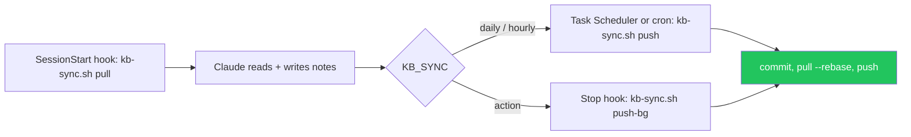

`~/.claude/hooks/kb-sync.sh` pulls on session start; pushes follow `KB_SYNC`. A failed push is reported at the next session start; push by hand with `~/.claude/hooks/kb-sync.sh push`. Bot auth: access token via `~/.claude/hooks/kb-credential.sh`, read from `~/.config/kb/token` (mode 600) or `KB_TOKEN`; never put the token in a URL, note or `~/.bashrc`. GitHub: fine-grained token, only this repo, Contents + Workflows read/write. GitLab: project access token, Maintainer, `write_repository`. Never commit `.obsidian/workspace*.json`. CI Secret Detection (`.github/workflows/secret-detection.yml` or `.gitlab-ci.yml`, copied from `setup/ci/`) runs only on a schedule or by hand, never on push, so syncs do not use CI minutes.

## Privacy
Never secrets, tokens, passwords or customer data, in any mode. `KB_PRIVACY=content`: no personal names or emails in notes or commits. `KB_PRIVACY=personal`: the user's profile lives in `Me.md` and people may be named with their role. Paths as `~/...`, `%USERPROFILE%\...` or `/mnt/c/Users/<windows-user>/...`. With `KB_AUTHOR=bot` commits are authored as `Knowledgebase Bot` (repo-local git config, email not linked to any account), so they never count as personal activity.
~~~~

### `Dashboard.base`
~~~~
filters:
  and:
    - file.ext == "md"
    - type
    - file.inFolder("Templates") == false
views:
  - type: table
    name: Open Issues
    filters:
      and:
        - type == "issue"
        - status != "done"
    groupBy:
      property: project
      direction: ASC
    order:
      - file.name
      - issue
      - status
      - branch
      - updated
  - type: table
    name: Decisions
    filters: type == "decision"
    order:
      - file.name
      - project
      - status
      - created
  - type: table
    name: Bugs
    filters: type == "bug"
    order:
      - file.name
      - project
      - severity
      - status
      - created
  - type: table
    name: Lessons
    filters: type == "lesson"
    order:
      - file.name
      - scope
      - project
      - created
  - type: table
    name: Recently Updated
    order:
      - file.name
      - type
      - project
      - file.mtime
    limit: 20
  - type: table
    name: Security Open
    filters:
      and:
        - type == "finding"
        - status == "open" || status == "in-progress"
    groupBy:
      property: project
      direction: ASC
    order:
      - file.name
      - severity
      - category
      - location
      - last_seen
  - type: table
    name: False Positives
    filters:
      and:
        - type == "finding"
        - status == "false-positive" || status == "accepted-risk"
    order:
      - file.name
      - project
      - status
      - fp_reason
      - fp_confirmed
  - type: table
    name: Audits
    filters: type == "audit"
    order:
      - file.name
      - project
      - date
      - new
      - recurring
      - fixed
  - type: table
    name: Reviews
    filters: type == "review"
    groupBy:
      property: project
      direction: ASC
    order:
      - file.name
      - kind
      - target
      - verdict
      - open
      - date
~~~~

### `Home.md`
~~~~
---
type: index
updated: 2026-10-19
tags:
  - index
---

# Home

> [!abstract] Knowledgebase
> Decision log and memory for all Claude Code work. Claude reads it before work and writes to it after.

> [!tip] Start here
> 1. [[Conventions]]: how notes are named, linked, formatted and kept up to date
> 2. [[Lessons]]: mistakes that must not happen again (read every session)
> 3. Project note of the repo you work in (below)
> 4. [[Security Audit Procedure]]: before any vuln check

## Projects
<!-- one line per repo: - [[repo-name]]: one-line summary -->

## How notes link
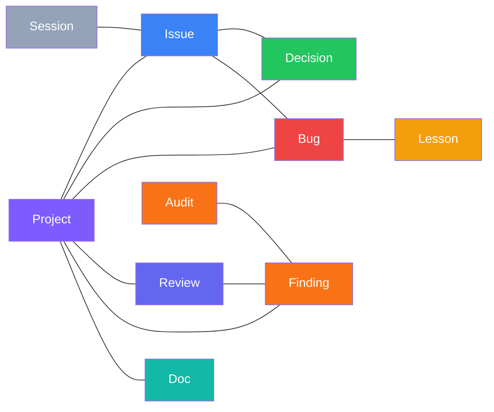

## Dashboard
![[Dashboard.base#Open Issues]]

![[Dashboard.base#Reviews]]

![[Dashboard.base#Security Open]]

![[Dashboard.base#Recently Updated]]

## Folders
| Folder | Holds |
|---|---|
| `Projects/` | One overview note per repo |
| `Issues/` | One note per issue/ticket: problem, plan, log, result |
| `Decisions/` | Decisions with context, options, consequences |
| `Bugs/` | Bugs found + root cause + fix |
| `Lessons/` | Mistakes to never repeat (indexed in [[Lessons]]) |
| `Docs/` | Feature and technical documentation |
| `Sessions/` | Daily log `YYYY-MM-DD` of what was done |
| `Reviews/` | Protocol of every code/branch/MR review with findings + verdict |
| `Security/` | Every vulnerability finding ever (incl. false positives) + `Audits/` |
| `Claude/` | Claude Code setup: plugins, skills, commands, MCP, hooks, restore runbook |
| `Templates/` | Note templates |
| `setup/` | Installer (`install.sh`), hook scripts, CLAUDE.md section: source of truth for new machines |
~~~~

### `Lessons.md`
~~~~
---
type: index
updated: 2026-10-19
tags:
  - index
---

# Lessons

> [!danger] Read at the start of every session
> One line per lesson: `- [[Lesson note]]: rule in one sentence`. Global lessons apply everywhere, project lessons only in that repo.

## Global

## Per Project
<!-- ### [[repo-name]] -->
~~~~

### `Project.base`
~~~~
filters:
  and:
    - file.ext == "md"
    - file.hasLink(this.file)
    - type != "session"
views:
  - type: table
    name: Linked
    groupBy:
      property: type
      direction: ASC
    order:
      - file.name
      - status
      - issue
      - updated
~~~~

### `Security/Security Audit Procedure.md`
~~~~
---
type: index
updated: 2026-10-19
tags:
  - index
  - security
---

# Security Audit Procedure

> [!danger] Summary
> Every vulnerability ever found lives in `Security/` as one finding note, never deleted. Every audit gets a note in `Security/Audits/`. Every hit is reported, known false positives too.

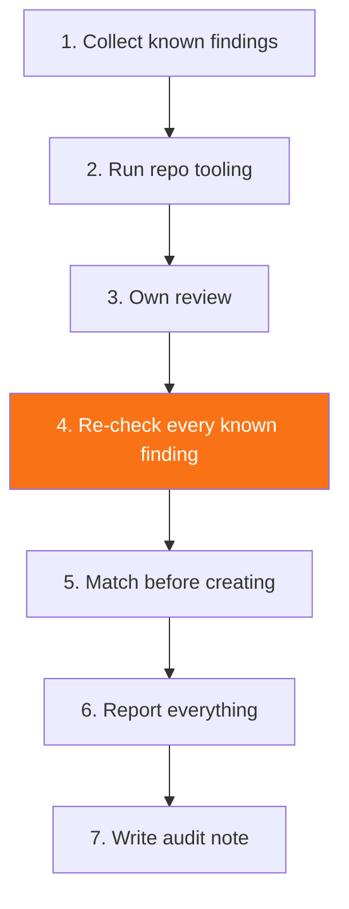

## When asked to check for vulnerabilities
| Step | What |
|---|---|
| 1. **Collect known findings** | all `Security/` notes with `project: "[[repo]]"`, every status, including fixed and false positives |
| 2. **Run everything the repo offers** | dependency audits (`npm audit`, `composer audit`, `pip-audit`, ...), configured SAST/linters with security rules, CI security jobs, existing security scripts/tests |
| 3. **Own review** | auth/session, access control, injection (SQL, command, template), XSS, CSRF, SSRF, secrets in code/config, unsafe deserialization, file upload/path traversal, dependency risk, misconfiguration |
| 4. **Re-check every known finding** | see table below |
| 5. **Match before creating** | same location + same class = same finding, update it instead of creating a duplicate |
| 6. **Report everything** | the audit result lists **every** finding that was hit, including false positives and accepted risks; never silently filter a known one |
| 7. **Write the audit note** | counts and links to every finding touched |

### Re-checking known findings
| Status | Action |
|---|---|
| 🔴 `open` | still present? update `last_seen` |
| ✅ `fixed` | regressed? reopen and note in History |
| 🔍 `false-positive` / 🛡️ `accepted-risk` | shows up again → **flag it again** and **ask the user**: "Still a false positive / still accepted?" |

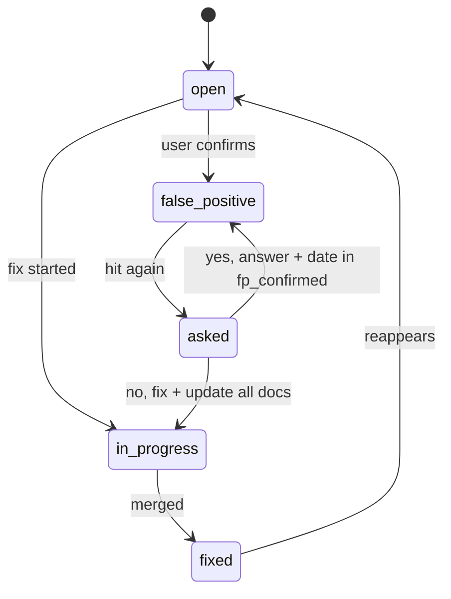

## Status values
`open | in-progress | fixed | false-positive | accepted-risk`

## Rules
> [!danger] Rules
> - Describe vulnerability class and location, never a working exploit
> - No secrets, tokens or customer data in notes, even when they are the finding: write "hardcoded API key in `config.ts:12`", not the key
> - Vault repo must stay **private**

## Views
![[Dashboard.base#Security Open]]

![[Dashboard.base#False Positives]]
~~~~

### `Templates/Audit.md`
~~~~
---
type: audit
project: "[[]]"
date: {{date}}
scope: 
tools: []
new: 0
recurring: 0
fixed: 0
false_positive: 0
created: {{date}}
updated: {{date}}
tags:
  - security
  - audit
---

# {{title}}

> [!abstract] Summary
> What was audited and the result in one line.

| Field | Value |
|---|---|
| Project | [[]] |
| Date | {{date}} |
| Scope | branch / commit |
| Result | 🔴 new 0 · 🟠 recurring 0 · ✅ fixed 0 · 🔍 still FP 0 |

## Scope
Branch / commit, paths covered, what was excluded.

## Checks Run
| Check | Tool / method | Result |
|---|---|---|
| Dependencies | `npm audit` / `composer audit` | ✅ |
| SAST / linters | | ✅ |
| CI security jobs | | ✅ |
| Known findings re-checked | [[Security Audit Procedure]] | ✅ |
| Own review | auth, input validation, injection, XSS, secrets, access control, config | ✅ |

## Results
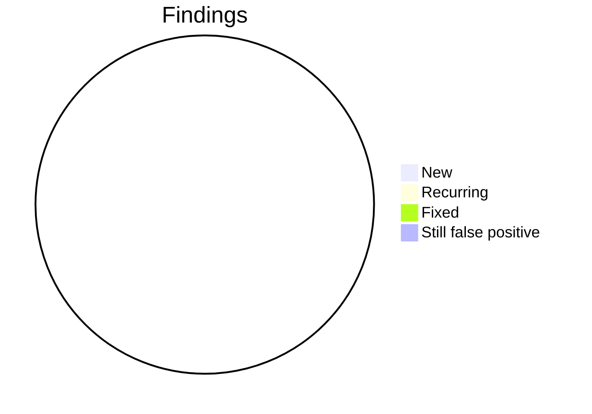

| Finding | Severity | Status | Change |
|---|---|---|---|
| [[]] | 🟠 medium | 🔴 open | new / recurring / fixed / still FP |

## Questions for the User
> [!question] Still a false positive?
> Every re-found false positive / accepted risk, flagged again. Record the answer: yes → kept, no → fixed + docs updated.
~~~~

### `Templates/Bug.md`
~~~~
---
type: bug
project: "[[]]"
issue: 
status: fixed
severity: medium
created: {{date}}
updated: {{date}}
tags:
  - bug
---

# {{title}}

> [!abstract] Summary
> One line: what broke, why, current state.

| Field | Value |
|---|---|
| Project | [[]] |
| Status | ✅ fixed |
| Severity | 🟠 medium |
| Issue | |
| Location | `path/file.ts:42` |

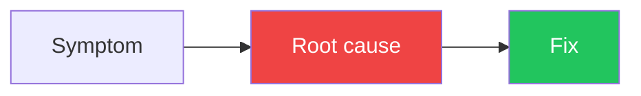

## Symptom
> [!bug] Error
> Exact error text / observed behavior.

## Root Cause
Why it happened. File + line.

## Fix
> [!success] Fix
> What changed. Link issue note / MR.

## Prevention
How to avoid it. If it was a mistake by Claude, add a [[Lessons]] entry.
~~~~

### `Templates/Decision.md`
~~~~
---
type: decision
project: "[[]]"
status: accepted
issue: 
created: {{date}}
updated: {{date}}
supersedes: 
superseded_by: 
tags:
  - decision
---

# {{title}}

> [!abstract] Summary
> One line: what was decided.

| Field | Value |
|---|---|
| Project | [[]] |
| Status | ✅ accepted |
| Decided by | user / Claude with approval |
| Supersedes | |

## Context
> [!info] Why a decision was needed
> Constraints.

## Options
| # | Option | Pros | Cons |
|---|---|---|---|
| 1 | **Option A** | | |
| 2 | **Option B** ✅ | | |

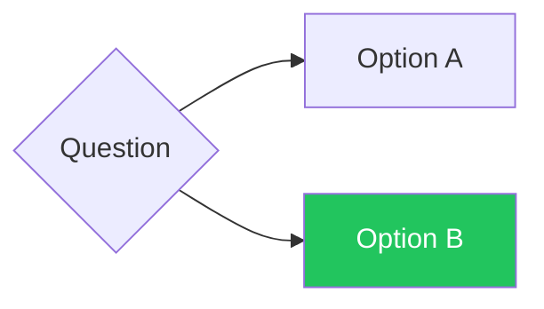

## Decision
> [!success] Chosen
> What was chosen and why.

## Consequences
- What this implies for future work
> [!warning] Before changing it
> What to check.
~~~~

### `Templates/Doc.md`
~~~~
---
type: doc
project: "[[]]"
created: {{date}}
updated: {{date}}
tags:
  - doc
---

# {{title}}

> [!abstract] Covers
> What this doc explains and when to read it.

| Field | Value |
|---|---|
| Project | [[]] |
| Code | `path/` |

## Overview
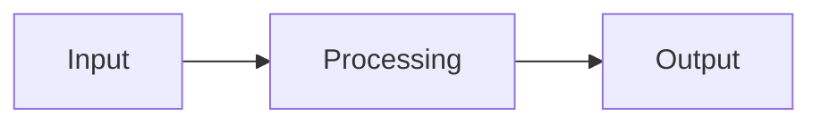

## Content
~~~~

### `Templates/Finding.md`
~~~~
---
type: finding
id: 
project: "[[]]"
status: open
severity: medium
category: 
cwe: 
location: 
found_by: 
first_found: {{date}}
last_seen: {{date}}
fp_reason: 
fp_confirmed: 
audits: []
issue: 
created: {{date}}
updated: {{date}}
tags:
  - security
---

# {{title}}

> [!danger] Summary
> Vulnerability class, location, current status in one line.

| Field | Value |
|---|---|
| ID | |
| Project | [[]] |
| Status | 🔴 open |
| Severity | 🟠 medium |
| Category / CWE | |
| Location | `path/file.ts:42` |
| First found / last seen | {{date}} / {{date}} |

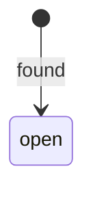

## Finding
What is vulnerable, `path/file.ts:42`, how it can be exploited (class of issue, no working exploit).

## Evidence
> [!example]- Evidence
> Tool output / code excerpt reference / reproduction conditions.

## Assessment
| Question | Answer |
|---|---|
| Reachable? | |
| Authenticated? | |
| Data at risk? | |

## Resolution
> [!success] Resolution
> - Fix: what changed, MR, linked issue note
> - or False positive: why, who confirmed, date
> - or Accepted risk: why, who decided, date

## History
| Date | Event |
|---|---|
| {{date}} | found by <tool/manual> in audit [[]] |
~~~~

### `Templates/Issue.md`
~~~~
---
type: issue
project: "[[]]"
issue: 
url: 
status: open
branch: 
mr: 
created: {{date}}
updated: {{date}}
tags:
  - issue
---

# {{title}}

> [!abstract] Summary
> What is asked, current state in one line.

| Field | Value |
|---|---|
| Project | [[]] |
| Issue | [#](url) |
| Status | 🔴 open |
| Branch | |
| MR | |

## Problem
> [!info] Acceptance criteria
> Quote them.

## Context
| File | Role |
|---|---|
| `path/file.ts:42` | |

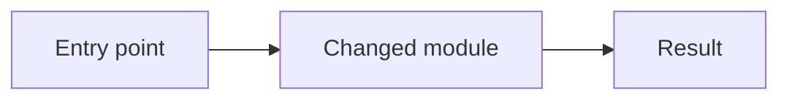

## Plan
- [ ] 

## Log
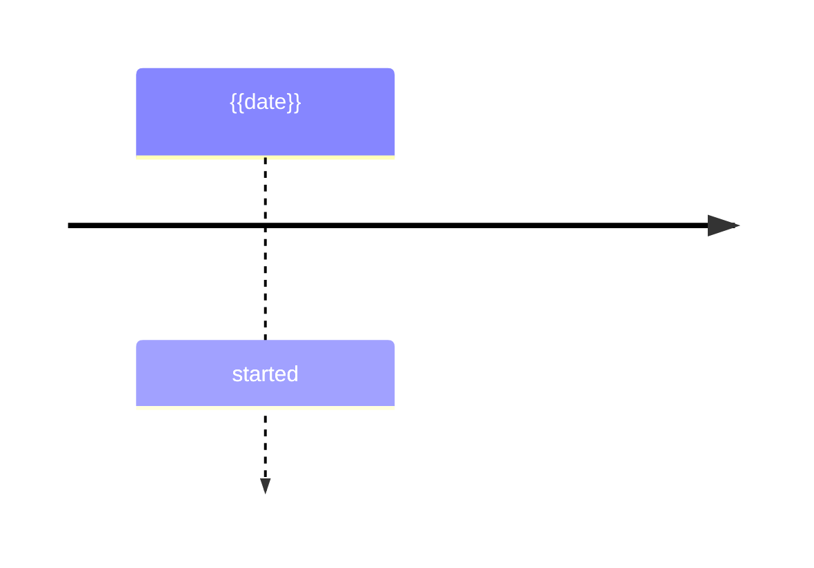

| Date | Entry |
|---|---|
| {{date}} | |

## Result
> [!success] Result
> What changed, where, how it was verified.

> [!todo] Follow-ups
> - [ ] 
~~~~

### `Templates/Lesson.md`
~~~~
---
type: lesson
scope: global
project: 
created: {{date}}
updated: {{date}}
tags:
  - lesson
---

# {{title}}

> [!danger] Rule
> One sentence: what to do / never do.

| Field | Value |
|---|---|
| Scope | global / project |
| Source | [[]] |

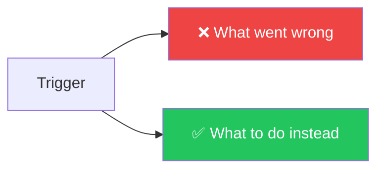

## What went wrong
> [!bug] Incident
> Concrete incident. Link the bug / issue / session note.

## Why
Root cause of the mistake.

## How to apply
> [!todo] When this rule kicks in
> What to do instead.
~~~~

### `Templates/Project.md`
~~~~
---
type: project
repo: 
path: 
remote: 
stack: []
status: active
created: {{date}}
updated: {{date}}
tags:
  - project
---

# {{title}}

> [!abstract] Summary
> What this repo is, who uses it, what it does.

| Field | Value |
|---|---|
| Repo | |
| Path | `~/...` |
| Stack | |
| Status | ✅ active |

## Stack & Setup
| Task | Command |
|---|---|
| Run | |
| Test | |
| Lint | |

## Architecture
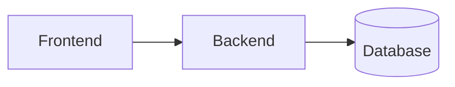

Key folders, data flow, important modules.

## Conventions
| Topic | Rule |
|---|---|
| Commits | |
| Branches | |

## Gotchas
> [!warning] Gotchas
> Non-obvious traps. Link the matching [[Lessons]] entries.

## Linked Notes
Auto-list of every issue, decision, bug, doc and lesson linking here.
![[Project.base]]
~~~~

### `Templates/Review.md`
~~~~
---
type: review
project: "[[]]"
kind: branch
target: 
mr: 
issue: 
reviewer: 
verdict: changes-requested
findings: 0
open: 0
previous: 
date: {{date}}
created: {{date}}
updated: {{date}}
tags:
  - review
---

# {{title}}

> [!abstract] Summary
> Target, verdict and open findings in one line.

| Field | Value |
|---|---|
| Project | [[]] |
| Target | branch / MR |
| Verdict | 🟡 changes-requested |
| Findings | 0 total · 0 open |
| Previous | |

## Scope
Branch / MR / commit range, files covered, what was out of scope.

## Verdict
> [!warning] changes-requested
> `approved | changes-requested | blocked` and why, in one or two sentences.

## Findings
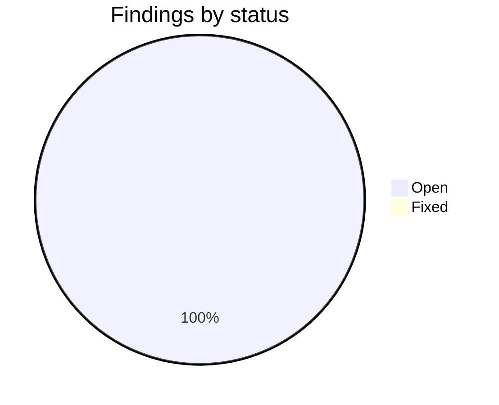

| # | Severity | Location | Finding | Status |
|---|---|---|---|---|
| 1 | 🔴 high | `path/file.ts:42` | | 🔴 open |

Status: `open | fixed | wont-fix | disputed`. Security findings also get a `Security/` note, link it here.

## Follow-up
- [ ] 

## History
| Date | Event |
|---|---|
| {{date}} | review done |
~~~~

### `Templates/Session.md`
~~~~
---
type: session
date: {{date}}
projects: []
tags:
  - session
---

# Session {{date}}

> [!abstract] Summary
> Main topics of the day in one line.

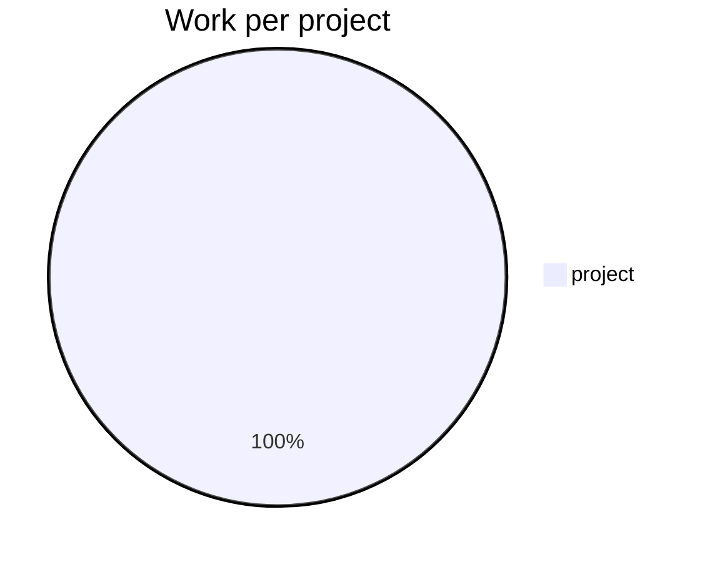

## Worked on
| Project | Topic | Result | Note |
|---|---|---|---|
| [[]] | | ✅ | [[]] |

## Created / Updated Notes
| Note | Change |
|---|---|
| [[]] | new / updated |

## Open Ends
- [ ] 
~~~~

### `setup/build-prompt.py`
~~~~
#!/usr/bin/env python3
"""Builds a self-contained Claude Code prompt that asks the setup questions and sets up a fresh knowledgebase vault for anyone.

The prompt embeds every template file of this vault (no personal notes), so it is always current.
Usage: python3 setup/build-prompt.py [output.md]
"""
import json
import os
import re
import sys
from datetime import date

VAULT = os.path.dirname(os.path.dirname(os.path.abspath(__file__)))
OUT = sys.argv[1] if len(sys.argv) > 1 else os.path.join(os.path.expanduser("~"), "knowledgebase-setup-prompt.md")

COPY = [
    ".gitignore", "Dashboard.base", "Project.base", "Conventions.md",
    "Security/Security Audit Procedure.md",
    ".obsidian/app.json", ".obsidian/appearance.json", ".obsidian/core-plugins.json",
    ".obsidian/daily-notes.json", ".obsidian/graph.json", ".obsidian/templates.json",
]
COPY_DIRS = ["Templates", "setup", ".obsidian/snippets"]
SKIP = set()
SKIP_PREFIXES = ("setup/claude/",)  # personal Claude Code backups, never shared
EMPTY_DIRS = ["Projects", "Issues", "Decisions", "Bugs", "Lessons", "Docs", "Sessions",
              "Security/Audits", "Reviews", "Attachments", "Claude"]

LESSONS = """---
type: index
updated: {date}
tags:
  - index
---

# Lessons

> [!danger] Read at the start of every session
> One line per lesson: `- [[Lesson note]]: rule in one sentence`. Global lessons apply everywhere, project lessons only in that repo.

## Global

## Per Project
<!-- ### [[repo-name]] -->
"""

PROMPT = """# Set up my Claude Knowledgebase

You are setting up a personal Obsidian knowledgebase for me that you (Claude Code) will read before every task and write to after it: issues, decisions, bugs, lessons, reviews and security findings. First you ask me how it should work (where it syncs, how often, who commits, what may be stored), then you build it exactly that way.

Work through the phases below strictly in order. Before each phase, tell me in one line which phase you are on (for example "Phase 4 of 8: Remote repo"). Where a phase needs me, print the exact instructions as a short numbered list, then stop and wait until I answer "done". Do everything else yourself. Skip steps that do not apply to my answers from phase 2 and say so in one line.

## Hard rules
- Never ask me to paste an access token into this chat and never print one. If I paste it anyway, tell me to revoke it and create a new one.
- Write every file in the "Files" section exactly as given, byte for byte. Do not reformat, translate or "improve" them. My answers go into `~/.config/kb/config` only; the installer adapts everything else.
- Before you change `~/.claude/settings.json` or `~/.claude/CLAUDE.md`, the installer makes a backup. Never overwrite either file by hand.
- If a command fails, show me the error, find the cause, fix it, then retry. Do not skip a phase.

## Phase 1: Check the system
Detect the platform: WSL on Windows (`grep -qi microsoft /proc/version`), macOS (`uname` = `Darwin`) or Linux. Native Windows without WSL is not supported: tell me to install WSL (`wsl --install` in PowerShell) and start Claude Code inside it.
Check `command -v git python3`; on WSL also `wslpath cmd.exe powershell.exe`; on macOS/Linux also `crontab`. If something is missing, tell me the exact command (e.g. `sudo apt install -y git python3 cron`, on macOS `xcode-select --install`) and wait.

## Phase 2: Questions
Ask me these questions, using your question tool if you have one (at most 4 per round, so 2 rounds), otherwise as one numbered list. Mark the recommended option. Skip a question when an earlier answer makes it pointless.
1. **Sync**: Should the vault be synced to **GitHub**, **GitLab** (gitlab.com or a self-hosted instance: ask for the URL) or **not at all** (local git only, nothing leaves this machine)? Recommended: GitHub or GitLab, so the vault survives a broken disk and works on several machines.
2. **How often** should changes be committed (and pushed, if synced)? **Once a day** (ask the time, default 12:00), **every hour**, or **after every single Claude action** (a hook after each response; most current, many small commits). Pulling always happens at every Claude start. Recommended: once a day.
3. **Who makes the commits** (only if synced)? **A bot** (commits authored as "Knowledgebase Bot", pushed with an access token / PAT that only has access to this one repo, so they do not count as my activity) or **me** (my own git name and email, pushed with the login I already use for git: credential manager, `gh`/`glab` auth or SSH key). Recommended: bot.
4. **What may be stored**: **content only** (projects, code, decisions, bugs, lessons; no personal names or emails) or **content + personal information** (also a `Me.md` profile with my role, skills, preferences and working style, and people I work with by name and role)? Secrets, passwords, tokens and customer data are never stored either way. Recommended: content only.
5. **Claude setup backup**: Should my Claude Code setup itself be saved in the vault as well (`Claude/backup/`: settings.json, CLAUDE.md, own commands, agents, hooks and skills, list of plugins, marketplaces and MCP servers; secrets redacted; with personal information also Claude's memory)? It is rewritten on every sync and restores with one script after a reinstall. Recommended: yes.
6. **Language** for the note text (file names and structure stay English). Default: the language I write to you in.
7. **Repo name** (only if synced), default `knowledgebase`, and whether Obsidian is already installed.

Then write my answers to `~/.config/kb/config` (create `~/.config/kb` with mode 700) in exactly this format, one value per line, and show me the file:
```
KB_REMOTE=github|gitlab|none
KB_SYNC=daily|hourly|action
KB_SYNC_TIME=HH:MM
KB_AUTHOR=bot|user
KB_PRIVACY=content|personal
KB_CLAUDE_BACKUP=yes|no
KB_LANGUAGE=<language>
```
Use `KB_AUTHOR=bot` when `KB_REMOTE=none` (local commits only). Ask me to confirm before you continue. I can change it later: edit the file, then run `bash ~/claude-knowledgebase/setup/install.sh` again.

## Phase 3: Obsidian
Skip if already installed. Tell me:
1. Download Obsidian from https://obsidian.md/download (on WSL: the Windows version) and install it.
2. Do not open or create a vault yet, that comes at the end.
Wait for "done".

## Phase 4: Remote repo and login
Skip if `KB_REMOTE=none`.
Tell me to create an empty **private** repo named as in phase 2, with no README, .gitignore or license:
- GitHub: https://github.com/new
- GitLab: `<gitlab-url>/projects/new` → **Create blank project**, visibility **Private**, untick "Initialize repository with a README"

If `KB_AUTHOR=bot`, also tell me to create the token:
- GitHub: https://github.com/settings/personal-access-tokens/new → **Fine-grained token**, name `knowledgebase-bot`, expiration as long as allowed, Repository access **Only select repositories** → the vault repo, Permissions → Repository: **Contents: Read and write** and **Workflows: Read and write**.
- GitLab: in the project **Settings → Access Tokens → Add new token**, name `knowledgebase-bot`, role **Maintainer**, scope **write_repository**, expiry as long as allowed.
- Put a calendar reminder one week before the expiry date: an expired token makes every sync fail.
- Open a separate terminal (not this chat) and run this, then paste the token when it asks. Input stays hidden:
  `(umask 077; mkdir -p ~/.config/kb && read -rsp "Token: " t && echo && printf '%s' "$t" > ~/.config/kb/token)`

If `KB_AUTHOR=user`: check `git config --global user.email`; if empty, tell me the two `git config --global` commands and wait. My existing git login is used for pushes; if I have none yet, suggest `gh auth login` (GitHub) or `glab auth login` (GitLab), or an SSH key.

Ask me for the clone URL (HTTPS, e.g. `https://github.com/<me>/knowledgebase.git`; SSH also works with `KB_AUTHOR=user`) and wait. With the bot, check `test -s ~/.config/kb/token` and that the mode is 600 (`ls -l ~/.config/kb/token` shows `-rw-------`). If it is missing, repeat the token step with me.

## Phase 5: Obsidian skills for Claude Code
Run:
```
claude plugin marketplace add kepano/obsidian-skills
claude plugin install obsidian@obsidian-skills
```
Tell me they become active after the restart at the end. If the commands fail, tell me to run `/plugin marketplace add kepano/obsidian-skills` and `/plugin install obsidian@obsidian-skills` in this session instead, and wait.

## Phase 6: Create the vault
1. Vault folder:
   - WSL: Obsidian cannot watch folders inside WSL, so the vault lives on the Windows drive, directly in the user folder and not under Documents (often synced by OneDrive, which can corrupt a `.git` folder): `WIN_HOME="$(wslpath "$(cmd.exe /c 'echo %USERPROFILE%' 2>/dev/null | tr -d '\\r')")"` and `VAULT="$WIN_HOME/claude-knowledgebase"`. If `$WIN_HOME` is itself inside a OneDrive folder, stop and ask me for another path on `C:`.
   - macOS / Linux: `VAULT="$HOME/claude-knowledgebase"` (not in an iCloud/Dropbox/OneDrive folder).
   If `$VAULT` already exists and is not empty, stop and ask me.
2. Get the repo into `$VAULT`:
   - `KB_REMOTE=none`: `git init -q -b main "$VAULT"`
   - `KB_AUTHOR=user`: `git clone <URL> "$VAULT"`
   - `KB_AUTHOR=bot`: clone with the token from the file, without putting the token into the URL:
     `git -c credential.helper= -c credential.helper='!f() {{ echo username=oauth2; echo "password=$(cat ~/.config/kb/token)"; }}; f' clone <URL> "$VAULT"`
   A warning about an empty repository is expected. "Authentication failed", 401/403 or "Repository not found" means the token is wrong or lacks access: go back to the token step of phase 4.
   After cloning, pin the branch name independent of local git defaults: `git -C "$VAULT" checkout -q -b main`.
3. Write every file from the "Files" section into `$VAULT` at its path. Create parent folders as needed.
4. Create these empty folders, each with an empty `.gitkeep` file: {empty}.
5. `chmod +x "$VAULT/setup/install.sh" "$VAULT/setup/restore-claude.sh" "$VAULT/setup/hooks/"*.sh`
6. Verify: `find "$VAULT" -path "$VAULT/.git" -prune -o -type f -print | wc -l` must print {count}.

## Phase 7: Link the vault to Claude Code
Read `$VAULT/setup/install.sh` so you know what it does, then run `bash "$VAULT/setup/install.sh" "$VAULT"`. Following `~/.config/kb/config` it links `~/claude-knowledgebase` (WSL), installs the pull-on-start hook and the push schedule (Windows Task Scheduler, cron or a Stop hook), sets the commit identity and login, adds the matching Secret Detection CI file, gives Claude Code access to the vault, writes the knowledgebase rules into `~/.claude/CLAUDE.md` and makes the first commit (and push). It is safe to run again after fixing an error.
Then verify and show me the result:
- `git -C ~/claude-knowledgebase log --format='%an | %s' -1` shows `Knowledgebase Bot` (bot) or my name (user)
- if synced: `git -C ~/claude-knowledgebase status -sb` shows no "ahead"
- if `KB_CLAUDE_BACKUP=yes`: `ls ~/claude-knowledgebase/Claude/backup` shows `settings.json` and `plugins.json`

## Phase 8: Finish
Tell me:
1. In Obsidian: **Open folder as vault** → the vault folder (WSL: `%USERPROFILE%\\claude-knowledgebase`). Folder colors, graph colors and dashboards load by themselves. If folders have no colors: Settings → Appearance → CSS snippets → enable `vault-colors`.
2. Restart Claude Code. From then on every session pulls the vault at start, changes are committed (and pushed) as chosen in phase 2, and the Obsidian skills are active. GitHub/GitLab: secret scanning runs weekly (GitLab: add a weekly pipeline schedule under **Build → Pipeline schedules**).
3. Start with: open a repo, start Claude Code and say "Create the project note for this repo in my knowledgebase".
4. To change a setting later: edit `~/.config/kb/config`, run `bash ~/claude-knowledgebase/setup/install.sh`.
Then summarize in at most five lines what was set up.

## Files
Each file below starts with its path relative to the vault. Write the content between the `~~~~` lines exactly.

{files}
"""


def template_files():
    files = {}
    for rel in COPY:
        src = os.path.join(VAULT, rel)
        if os.path.exists(src):
            files[rel] = open(src, encoding="utf-8").read()
    for d in COPY_DIRS:
        for root, _, names in os.walk(os.path.join(VAULT, d)):
            for f in sorted(names):
                rel = os.path.relpath(os.path.join(root, f), VAULT).replace(os.sep, "/")
                if rel not in SKIP and not rel.startswith(SKIP_PREFIXES):
                    files[rel] = open(os.path.join(root, f), encoding="utf-8").read()
    graph = json.loads(files[".obsidian/graph.json"])
    graph.update({"search": "-path:Claude/backup", "close": True, "scale": 1})
    files[".obsidian/graph.json"] = json.dumps(graph, indent=2)
    home = open(os.path.join(VAULT, "Home.md"), encoding="utf-8").read()
    home = re.sub(r"(## Projects\n<!--.*?-->\n).*?(\n## )", r"\1\2", home, flags=re.S)
    files["Home.md"] = re.sub(r"\n> 5\. \[\[Claude Setup\]\].*", "", home)
    files["Lessons.md"] = LESSONS.format(date=date.today().isoformat())
    return dict(sorted(files.items()))


def main():
    files = template_files()
    blocks = "\n".join(f"### `{path}`\n~~~~\n{text.rstrip(chr(10))}\n~~~~\n" for path, text in files.items())
    prompt = PROMPT.format(
        files=blocks, count=len(files) + len(EMPTY_DIRS),
        empty=", ".join(f"`{d}/`" for d in EMPTY_DIRS),
    )
    with open(OUT, "w", encoding="utf-8") as f:
        f.write(prompt)
    print(f"{OUT} ({len(files)} files, {len(prompt.splitlines())} lines)")


if __name__ == "__main__":
    main()
~~~~

### `setup/ci/github-secret-detection.yml`
~~~~
# Secret detection with gitleaks: https://github.com/gitleaks/gitleaks-action
# Vault syncs push automatically every day: run only on a schedule or when started by hand
name: Secret Detection

on:
  schedule:
    - cron: "0 6 * * 1"
  workflow_dispatch:

permissions:
  contents: read

jobs:
  gitleaks:
    runs-on: ubuntu-latest
    steps:
      - uses: actions/checkout@v4
        with:
          fetch-depth: 0
      - uses: gitleaks/gitleaks-action@v2
        env:
          GITHUB_TOKEN: ${{ secrets.GITHUB_TOKEN }}
~~~~

### `setup/ci/gitlab-ci.yml`
~~~~
# Secret Detection: https://docs.gitlab.com/user/application_security/secret_detection/pipeline/
# Vault syncs push often: run only on a pipeline schedule (CI/CD → Schedules, e.g. weekly) or when started by hand
workflow:
  rules:
    - if: $CI_PIPELINE_SOURCE == "schedule" || $CI_PIPELINE_SOURCE == "web"

stages:
  - secret-detection
variables:
  SECRET_DETECTION_ENABLED: 'true'
secret_detection:
  stage: secret-detection
include:
  - template: Security/Secret-Detection.gitlab-ci.yml
~~~~

### `setup/claude-backup.py`
~~~~
#!/usr/bin/env python3
"""Copies the Claude Code setup (~/.claude) into the vault, secrets redacted, so it can be restored after a reinstall.

Saved: CLAUDE.md, settings.json, commands/, agents/, output-styles/, hooks/, own skills (not symlinked ones),
plugin + marketplace lists, user MCP servers, and memory when KB_PRIVACY=personal.
Never saved: credentials, history, sessions, caches, plugin code. Restore: setup/restore-claude.sh
Usage: python3 setup/claude-backup.py <vault>/Claude/backup
"""
import json
import os
import re
import shutil
import sys

HOME = os.path.expanduser("~")
CLAUDE = os.path.join(HOME, ".claude")
OUT = sys.argv[1]
DIRS = ["commands", "agents", "output-styles", "hooks"]
MAX_BYTES = 512 * 1024
SECRET_KEY = re.compile(r"token|secret|password|passwd|api[_-]?key|auth|credential|cookie|private", re.I)
SKIP_NAMES = {".git", "node_modules", "__pycache__", ".venv", "venv", ".DS_Store"}


def config():
    conf = {}
    try:
        for line in open(os.path.join(HOME, ".config/kb/config"), encoding="utf-8"):
            m = re.match(r"\s*(\w+)=(.*)", line)
            if m:
                conf[m.group(1)] = m.group(2).strip().strip("'\"")
    except OSError:
        pass
    return conf


def redact(value, key=""):
    """Keeps structure, blanks every value under env/headers and every key that looks like a secret."""
    if isinstance(value, dict):
        return {k: ("<redacted>" if (key in ("env", "headers") or SECRET_KEY.search(k)) and not isinstance(v, (dict, list))
                    else redact(v, k)) for k, v in value.items()}
    if isinstance(value, list):
        return [redact(v, key) for v in value]
    return value


def write(rel, text):
    path = os.path.join(OUT, rel)
    os.makedirs(os.path.dirname(path), exist_ok=True)
    with open(path, "w", encoding="utf-8") as f:
        f.write(text)


def copy_tree(src, rel):
    for root, dirs, files in os.walk(src):
        dirs[:] = [d for d in dirs if d not in SKIP_NAMES]
        for f in files:
            p = os.path.join(root, f)
            if f in SKIP_NAMES or os.path.getsize(p) > MAX_BYTES:
                continue
            try:
                text = open(p, encoding="utf-8").read()
            except (UnicodeDecodeError, OSError):
                continue
            write(os.path.join(rel, os.path.relpath(p, src)), text)


def load(path):
    try:
        return json.load(open(path, encoding="utf-8"))
    except (OSError, ValueError):
        return {}


def main():
    if os.path.isdir(OUT):
        shutil.rmtree(OUT)
    os.makedirs(OUT)
    if os.path.exists(os.path.join(CLAUDE, "CLAUDE.md")):
        write("CLAUDE.md", open(os.path.join(CLAUDE, "CLAUDE.md"), encoding="utf-8").read())
    write("settings.json", json.dumps(redact(load(os.path.join(CLAUDE, "settings.json"))), indent=2) + "\n")
    for d in DIRS:
        if os.path.isdir(os.path.join(CLAUDE, d)):
            copy_tree(os.path.join(CLAUDE, d), d)
    skills_dir = os.path.join(CLAUDE, "skills")
    linked = []
    if os.path.isdir(skills_dir):
        for name in sorted(os.listdir(skills_dir)):
            p = os.path.join(skills_dir, name)
            if os.path.islink(p):
                linked.append(name)
            elif os.path.isdir(p):
                copy_tree(p, os.path.join("skills", name))
    installed = load(os.path.join(CLAUDE, "plugins/installed_plugins.json")).get("plugins", {})
    markets = load(os.path.join(CLAUDE, "plugins/known_marketplaces.json"))
    plugins = {
        "marketplaces": {name: m.get("source", {}) for name, m in sorted(markets.items())},
        "plugins": sorted(installed),
        "linked_skills": linked,
    }
    write("plugins.json", json.dumps(plugins, indent=2) + "\n")
    mcp = load(os.path.join(HOME, ".claude.json")).get("mcpServers", {})
    write("mcp-servers.json", json.dumps(redact(mcp), indent=2) + "\n")
    if config().get("KB_PRIVACY") == "personal":
        projects = os.path.join(CLAUDE, "projects")
        for name in sorted(os.listdir(projects)) if os.path.isdir(projects) else []:
            mem = os.path.join(projects, name, "memory")
            if os.path.isdir(mem):
                copy_tree(mem, os.path.join("memory", name))
    write("README.md", "# Claude setup backup\n\nAutomatic copy of `~/.claude`, written on every knowledgebase sync. "
          "Do not edit. Secrets are redacted. Restore: `bash ~/claude-knowledgebase/setup/restore-claude.sh`\n")


if __name__ == "__main__":
    main()
~~~~

### `setup/claude-md-section.md`
~~~~
## Knowledgebase (Obsidian vault)

Vault: `~/claude-knowledgebase` (symlink to the vault folder on the Windows drive, so Obsidian can watch it) — the single source of truth for issues, decisions, bugs, docs and lessons across all projects. Naming, frontmatter and linking rules: `Conventions.md` in the vault. Templates: `Templates/`.

**Before work (read):**
- Read `Lessons.md` at the start of every session and follow every rule in it
- Read `Projects/<repo-name>.md` of the current repo (if missing, create it from `Templates/Project.md` and add it to `Home.md#Projects`)
- Working on an issue → read its note in `Issues/` if it exists; search the vault (`grep -ril`) for the issue number, feature or error before investigating from scratch
- Before a non-trivial choice → check `Decisions/` so past decisions are not re-litigated or contradicted
- {{SYNC_RULE}}

**During and after work (write), in the same task, without being asked:**
- Issue started → create/update `Issues/` note: problem, plan, log entries, result, branch, MR link
- Decision made (by the user or approved by them: architecture, library, approach, trade-off) → `Decisions/` note with context, options, reason
- Bug found and fixed → `Bugs/` note with exact symptom, root cause (`file:line`), fix
- Mistake by Claude corrected by the user, or a failed approach → `Lessons/` note + one-line entry in `Lessons.md`, so it never happens again
- New knowledge about a repo (setup, architecture, gotcha, convention) → update `Projects/<repo-name>.md` or a `Docs/` note
- Code change contradicts a note → update that note in the same task, bump `updated`; superseded decisions get `status: superseded` + link to the new one
- End of every task → append to `Sessions/YYYY-MM-DD.md`: what was done, which notes changed, open ends
- Review done (branch, MR, `/code-review` or any other review command, self-review, or review comments received) → `Reviews/` note: scope, verdict, findings table with status, follow-ups; re-review of the same target gets a new note with `previous` linking the old one, and before reviewing, read earlier reviews of the same branch/MR
- Security finding (from any review, audit, tool or by accident) → `Security/` finding note, see below
- Link everything: each note links its project via `project: "[[repo-name]]"` and the related issue/decision/bug/doc notes via `[[wikilinks]]`, both directions

**Security & vulnerability audits** (full procedure: `Security/Security Audit Procedure.md`, read it before any vuln check):
- Every finding ever found gets one note in `Security/` and is never deleted; status `open | in-progress | fixed | false-positive | accepted-risk`
- When asked to check for vulnerabilities: run all security tooling the repo offers (dependency audits, SAST, CI security jobs, security tests) + own manual review + re-check **every** recorded finding of that project (open, fixed, false positive)
- Same location + same vulnerability class = same finding → update it (`last_seen`, History), never duplicate; a fixed finding that reappears gets reopened
- Always flag every finding that is hit, also known false positives and accepted risks; never filter them silently
- A finding marked `false-positive` or `accepted-risk` shows up again → flag it again and ask the user whether it still is one. Yes → keep status, record answer + date in `fp_confirmed`. No → fix it (`in-progress` → `fixed`) and update the finding and all affected docs in the same task
- Each audit gets a note in `Security/Audits/` linking every finding it touched
- Never write working exploits, secrets or customer data into findings; describe class + location only

**Rules:**
- Facts only, short, no filler; link `path/file.ts:42` instead of copying code
- Every note is visual Markdown: summary callout, key facts table, tables for 3+ comparable items, at least one Mermaid diagram, status badges (`Conventions.md#Formatting`); touching an old note → reformat it to that standard
- {{PRIVACY_RULE}}
- Write notes in {{LANGUAGE}}; file names, frontmatter keys and folder names stay as in `Conventions.md`
- Never delete notes; mark outdated content as superseded
- Changing this section or `kb-sync.sh` / `kb-credential.sh` → mirror the change into the vault's `setup/` folder (installer source)
- Sub-agents read the relevant vault notes too; only the main agent writes to the vault, to avoid conflicting edits
- The vault repo may be committed and pushed anytime without asking, even where other rules forbid commits (normally the sync hook does it); rules about suggesting commit messages do not apply to vault-only changes
- {{REMOTE_RULE}}
{{BACKUP_RULE}}
~~~~

### `setup/hooks/kb-credential.sh`
~~~~
#!/usr/bin/env bash
# Git credential helper for the knowledgebase vault; reads the bot token from an owner-only file.
[ "$1" = "get" ] || exit 0
TOKEN_FILE="$HOME/.config/kb/token"
token="${KB_TOKEN:-${KB_GITHUB_TOKEN:-}}"
[ -z "$token" ] && [ -r "$TOKEN_FILE" ] && token="$(cat "$TOKEN_FILE")"
[ -n "$token" ] || exit 0
host=""
while IFS='=' read -r k v; do [ "$k" = "host" ] && host="$v"; done
# GitHub tokens use any username, GitLab project/personal tokens expect oauth2
case "$host" in github.com|*.github.com) echo "username=x-access-token";; *) echo "username=oauth2";; esac
echo "password=$token"
~~~~

### `setup/hooks/kb-sync.sh`
~~~~
#!/usr/bin/env bash
# Syncs the Obsidian knowledgebase vault with its git remote. Settings: ~/.config/kb/config
# Usage: kb-sync.sh pull     (session start: pull only, report last push failure)
#        kb-sync.sh push     (scheduled task / by hand: Claude backup, commit, pull, push if ahead)
#        kb-sync.sh push-bg  (Stop hook: push in the background so Claude is not blocked)
VAULT="$HOME/claude-knowledgebase"
MODE="${1:-push}"
ERR_FILE="$HOME/.cache/kb-sync.last-error"
LOCK="$HOME/.cache/kb-sync.lock"
KB_CLAUDE_BACKUP=no
[ -r "$HOME/.config/kb/config" ] && . "$HOME/.config/kb/config"
cd "$VAULT" 2>/dev/null || exit 0
git rev-parse --git-dir >/dev/null 2>&1 || exit 0
mkdir -p "$HOME/.cache"

if [ "$MODE" = "push-bg" ]; then
  nohup "$0" push >>"$HOME/.cache/kb-sync.log" 2>&1 </dev/null &
  exit 0
fi

# timeout and flock are missing on stock macOS
t() { if command -v timeout >/dev/null; then timeout "$@"; else shift; "$@"; fi; }
if command -v flock >/dev/null; then
  exec 9>"$LOCK"; flock -w 60 9 || exit 0
else
  for _ in $(seq 60); do mkdir "$LOCK.d" 2>/dev/null && break; sleep 1; done
  [ -d "$LOCK.d" ] || exit 0
  trap 'rmdir "$LOCK.d" 2>/dev/null' EXIT
fi

export GIT_TERMINAL_PROMPT=0
BRANCH="$(git symbolic-ref --short HEAD)"
HAS_REMOTE="$(git remote | grep -qx origin && echo 1)"
has_upstream() { [ -n "$HAS_REMOTE" ] && t 15 git ls-remote --exit-code --heads origin "$BRANCH" >/dev/null 2>&1; }

fail() {
  [ "$MODE" = "push" ] && printf '%s: %s\n' "$(date '+%Y-%m-%d %H:%M')" "$1" > "$ERR_FILE"
  printf '{"systemMessage":"Knowledgebase sync (%s) failed: %s"}\n' "$MODE" "$1"
  exit 0
}
pull() {
  has_upstream || return 0
  pull_err="$(t 30 git pull -q --rebase --autostash origin "$BRANCH" 2>&1)" \
    || { git rebase --abort 2>/dev/null; fail "pull failed: $(printf '%s' "$pull_err" | tail -1 | tr -d '"')"; }
}

if [ "$MODE" = "pull" ]; then
  if [ -s "$ERR_FILE" ]; then
    printf '{"systemMessage":"Last knowledgebase push failed (%s). Run: ~/.claude/hooks/kb-sync.sh push"}\n' "$(tr -d '\n"' < "$ERR_FILE")"
  fi
  pull
  exit 0
fi

if [ "$KB_CLAUDE_BACKUP" = "yes" ] && [ -f "$VAULT/setup/claude-backup.py" ]; then
  python3 "$VAULT/setup/claude-backup.py" "$VAULT/Claude/backup" >/dev/null 2>&1 || fail "Claude setup backup"
fi
if [ -n "$(git status --porcelain)" ]; then
  git add -A && git commit -qm "docs: knowledgebase update $(date '+%Y-%m-%d %H:%M')" || fail "commit"
fi
[ -n "$HAS_REMOTE" ] || { rm -f "$ERR_FILE"; exit 0; }
pull
if [ -n "$(git log origin/"$BRANCH"..HEAD 2>/dev/null || git log --oneline -1)" ]; then
  t 30 git push -q -u origin "$BRANCH" 2>/dev/null || fail "push"
fi
rm -f "$ERR_FILE"
exit 0
~~~~

### `setup/install.sh`
~~~~
#!/usr/bin/env bash
# Links an already cloned (or git init'ed) knowledgebase vault to Claude Code on WSL, macOS or Linux. Safe to run again.
# Settings come from ~/.config/kb/config (see setup/kb.conf.example); change them and run again to apply.
# Usage: bash setup/install.sh [vault-path]
set -euo pipefail

LINK="$HOME/claude-knowledgebase"
HOOKS="$HOME/.claude/hooks"
SETTINGS="$HOME/.claude/settings.json"
CLAUDE_MD="$HOME/.claude/CLAUDE.md"
CONF="$HOME/.config/kb/config"
TOKEN_FILE="$HOME/.config/kb/token"
TASK="Claude Knowledgebase Sync"

ok()   { printf '  \033[32m✓\033[0m %s\n' "$1"; }
info() { printf '\n\033[1m%s\033[0m\n' "$1"; }
t()    { if command -v timeout >/dev/null; then timeout "$@"; else shift; "$@"; fi; }
die()  { printf '\n\033[31m✗ %s\033[0m\n' "$1" >&2; exit 1; }

info "1/7 Requirements and settings"
if grep -qi microsoft /proc/version 2>/dev/null; then OS=wsl; elif [ "$(uname)" = Darwin ]; then OS=mac; else OS=linux; fi
for cmd in git python3; do command -v "$cmd" >/dev/null || die "'$cmd' missing"; done
[ "$OS" = wsl ] && for cmd in wslpath cmd.exe powershell.exe; do command -v "$cmd" >/dev/null || die "'$cmd' missing: run inside WSL with Windows interop on"; done
[ "$OS" != wsl ] && ! command -v crontab >/dev/null && die "'crontab' missing (Linux: sudo apt install -y cron)"
KB_REMOTE=github KB_SYNC=daily KB_SYNC_TIME=12:00 KB_AUTHOR=bot KB_PRIVACY=content KB_CLAUDE_BACKUP=no KB_LANGUAGE=English
[ -r "$CONF" ] && . "$CONF"
case "$KB_REMOTE" in github|gitlab|none) ;; *) die "KB_REMOTE must be github, gitlab or none (in $CONF)";; esac
case "$KB_SYNC" in daily|hourly|action) ;; *) die "KB_SYNC must be daily, hourly or action";; esac
case "$KB_AUTHOR" in bot|user) ;; *) die "KB_AUTHOR must be bot or user";; esac
case "$KB_PRIVACY" in content|personal) ;; *) die "KB_PRIVACY must be content or personal";; esac
[[ "$KB_SYNC_TIME" =~ ^([01][0-9]|2[0-3]):[0-5][0-9]$ ]] || die "KB_SYNC_TIME must be HH:MM"
ok "$OS · remote $KB_REMOTE · sync $KB_SYNC · author $KB_AUTHOR · privacy $KB_PRIVACY · Claude backup $KB_CLAUDE_BACKUP"

info "2/7 Finding the vault"
VAULT="${1:-}"
[ -z "$VAULT" ] && [ -e "$LINK" ] && VAULT="$(cd "$LINK" && pwd -P)"
if [ "$OS" = wsl ]; then
  WIN_HOME="$(wslpath "$(cmd.exe /c 'echo %USERPROFILE%' 2>/dev/null | tr -d '\r')")"
  [ -z "$VAULT" ] && VAULT="$WIN_HOME/claude-knowledgebase"
  case "$VAULT" in /mnt/[a-z]/*) ;; *) die "$VAULT is inside WSL. Obsidian cannot watch it there: put it on the Windows drive (e.g. $WIN_HOME/claude-knowledgebase)";; esac
fi
[ -z "$VAULT" ] && VAULT="$LINK"
[ -d "$VAULT/.git" ] || die "No git repo at $VAULT. Clone your repo there (or git init it) first, or pass its path: install.sh <path>"
[ -f "$VAULT/setup/hooks/kb-sync.sh" ] || die "$VAULT has no setup/ folder. Copy the knowledgebase template into it first"
VAULT="$(cd "$VAULT" && pwd -P)"
ok "Vault: $VAULT"
if [ "$VAULT" != "$LINK" ]; then
  if [ -L "$LINK" ] || [ ! -e "$LINK" ]; then ln -sfn "$VAULT" "$LINK"; ok "Linked $LINK"
  elif [ "$(cd "$LINK" && pwd -P)" != "$VAULT" ]; then die "$LINK exists and is not a link. Move it away and run again"; fi
fi

info "3/7 Remote and login"
REMOTE="$(git -C "$VAULT" remote get-url origin 2>/dev/null || true)"
HOST=""
if [ "$KB_REMOTE" = none ]; then
  [ -z "$REMOTE" ] || die "KB_REMOTE=none but the vault has a remote ($REMOTE). Remove it (git remote remove origin) or change KB_REMOTE"
  ok "No remote: commits stay on this machine"
else
  [ -n "$REMOTE" ] || die "Vault has no 'origin' remote"
  if [ "$KB_AUTHOR" = bot ] && [[ "$REMOTE" =~ ^(ssh://)?git@([^:/]+)(:[0-9]+)?[:/](.+)$ ]]; then
    REMOTE="https://${BASH_REMATCH[2]}/${BASH_REMATCH[4]}"
    git -C "$VAULT" remote set-url origin "$REMOTE"
    ok "Switched remote to HTTPS so pushes use the token: $REMOTE"
  fi
  case "$REMOTE" in https://*) HOST="$(printf '%s' "$REMOTE" | sed -E 's#https://([^/@]*@)?([^/]+)/.*#\2#')";; esac
  ok "Remote: $REMOTE"
  if [ "$KB_AUTHOR" = bot ]; then
    [ -n "$HOST" ] || die "KB_AUTHOR=bot needs an HTTPS remote"
    if [ ! -s "$TOKEN_FILE" ]; then
      read -rsp "  Paste the access token (input hidden): " token </dev/tty; echo
      [ -n "$token" ] || die "No token given"
      (umask 077; mkdir -p "$(dirname "$TOKEN_FILE")"; printf '%s' "$token" > "$TOKEN_FILE")
    fi
    chmod 600 "$TOKEN_FILE"
    ok "Token in $TOKEN_FILE (owner-only)"
  else
    ok "Your own git login is used (credential manager, gh/glab auth or SSH key)"
  fi
fi

info "4/7 Hook scripts and git identity"
mkdir -p "$HOOKS"
install -m 755 "$VAULT/setup/hooks/kb-sync.sh" "$HOOKS/kb-sync.sh"
install -m 700 "$VAULT/setup/hooks/kb-credential.sh" "$HOOKS/kb-credential.sh"
git -C "$VAULT" config core.autocrlf false
git -C "$VAULT" config core.filemode false
if [ -n "$HOST" ]; then git -C "$VAULT" config --unset-all "credential.https://$HOST.helper" 2>/dev/null || true; fi
if [ "$KB_AUTHOR" = bot ]; then
  git -C "$VAULT" config user.name "Knowledgebase Bot"
  git -C "$VAULT" config user.email "knowledgebase-bot@noreply.${HOST:-local}"
  if [ -n "$HOST" ]; then
    git -C "$VAULT" config "credential.https://$HOST.helper" ""
    git -C "$VAULT" config --add "credential.https://$HOST.helper" "$HOOKS/kb-credential.sh"
  fi
  ok "Commits as Knowledgebase Bot"
else
  git -C "$VAULT" config --unset user.name 2>/dev/null || true
  git -C "$VAULT" config --unset user.email 2>/dev/null || true
  [ -n "$(git -C "$VAULT" config user.email)" ] || die "No git identity. Run: git config --global user.name \"Your Name\" && git config --global user.email you@example.com"
  ok "Commits as $(git -C "$VAULT" config user.name)"
fi
if [ "$KB_REMOTE" != none ]; then
  GIT_TERMINAL_PROMPT=0 t 30 git -C "$VAULT" ls-remote origin >/dev/null 2>&1 || {
    [ "$KB_AUTHOR" = bot ] && die "Cannot reach $REMOTE. Check the token: access to this repo, write rights (GitHub: Contents + Workflows read/write; GitLab: write_repository, Maintainer)"
    die "Cannot reach $REMOTE with your login. Run 'git ls-remote $REMOTE' in a terminal and sign in (or set up gh auth login / an SSH key), then run again"; }
  ok "Remote reachable"
fi
if [ "$KB_REMOTE" = github ] && [ ! -e "$VAULT/.github/workflows/secret-detection.yml" ]; then
  mkdir -p "$VAULT/.github/workflows"; cp "$VAULT/setup/ci/github-secret-detection.yml" "$VAULT/.github/workflows/secret-detection.yml"
  ok "Secret Detection workflow added (weekly + manual)"
elif [ "$KB_REMOTE" = gitlab ] && [ ! -e "$VAULT/.gitlab-ci.yml" ]; then
  cp "$VAULT/setup/ci/gitlab-ci.yml" "$VAULT/.gitlab-ci.yml"
  ok "Secret Detection pipeline added (schedule + manual)"
fi

info "5/7 Claude Code settings"
[ -f "$SETTINGS" ] && cp "$SETTINGS" "$SETTINGS.bak.$(date +%Y%m%d-%H%M%S)"
python3 - "$SETTINGS" "$VAULT" "$KB_SYNC" <<'PY'
import json, os, sys
path, vault, sync = sys.argv[1:4]
d = json.load(open(path)) if os.path.exists(path) else {}
dirs = d.setdefault("permissions", {}).setdefault("additionalDirectories", [])
if vault not in dirs: dirs.append(vault)
hooks = d.setdefault("hooks", {})
want = {"SessionStart": {"type": "command", "command": "\"$HOME/.claude/hooks/kb-sync.sh\" pull", "timeout": 60, "statusMessage": "Syncing knowledgebase..."}}
if sync == "action":
    want["Stop"] = {"type": "command", "command": "\"$HOME/.claude/hooks/kb-sync.sh\" push-bg", "timeout": 10}
for event in ("SessionStart", "Stop"):
    for g in hooks.get(event, []):
        g["hooks"] = [h for h in g.get("hooks", []) if "kb-sync" not in h.get("command", "")]
    if event in hooks:
        hooks[event] = [g for g in hooks[event] if g.get("hooks")]
        if not hooks[event]: del hooks[event]
for event, hook in want.items():
    groups = hooks.setdefault(event, [])
    if groups: groups[0].setdefault("hooks", []).append(hook)
    else: groups.append({"hooks": [hook]})
os.makedirs(os.path.dirname(path), exist_ok=True)
json.dump(d, open(path, "w"), indent=2)
PY
ok "Vault access, pull on session start$([ "$KB_SYNC" = action ] && echo ', push after every Claude response')"

info "6/7 Scheduled sync"
CMD='~/.claude/hooks/kb-sync.sh push >> ~/.cache/kb-sync.log 2>&1'
H="${KB_SYNC_TIME%%:*}"; M="${KB_SYNC_TIME##*:}"
if [ "$OS" = wsl ]; then
  if [ "$KB_SYNC" = action ]; then
    powershell.exe -NoProfile -Command "Unregister-ScheduledTask -TaskName '$TASK' -Confirm:\$false -ErrorAction SilentlyContinue" >/dev/null 2>&1 || true
    ok "No scheduled task (sync runs after every Claude response)"
  else
    if [ "$KB_SYNC" = daily ]; then TRIGGER="New-ScheduledTaskTrigger -Daily -At $KB_SYNC_TIME"
    else TRIGGER="New-ScheduledTaskTrigger -Once -At (Get-Date).Date -RepetitionInterval (New-TimeSpan -Hours 1)"; fi
    powershell.exe -NoProfile -Command "
      \$a = New-ScheduledTaskAction -Execute 'conhost.exe' -Argument '--headless wsl.exe -d $WSL_DISTRO_NAME -e bash -lc \"$CMD\"';
      \$t = $TRIGGER;
      \$s = New-ScheduledTaskSettingsSet -StartWhenAvailable -AllowStartIfOnBatteries -DontStopIfGoingOnBatteries -ExecutionTimeLimit (New-TimeSpan -Minutes 5);
      Register-ScheduledTask -TaskName '$TASK' -Action \$a -Trigger \$t -Settings \$s -Force | Out-Null" >/dev/null 2>&1 \
      || die "Could not create the Windows scheduled task"
    ok "Windows Task Scheduler: $([ "$KB_SYNC" = daily ] && echo "daily at $KB_SYNC_TIME" || echo hourly), catches up if the PC was off"
  fi
else
  { crontab -l 2>/dev/null | grep -v 'kb-sync.sh' || true; } > "${TMPDIR:-/tmp}/kb-cron.$$"
  case "$KB_SYNC" in
    daily)  echo "$((10#$M)) $((10#$H)) * * * $CMD" >> "${TMPDIR:-/tmp}/kb-cron.$$";;
    hourly) echo "0 * * * * $CMD" >> "${TMPDIR:-/tmp}/kb-cron.$$";;
  esac
  crontab "${TMPDIR:-/tmp}/kb-cron.$$"; rm -f "${TMPDIR:-/tmp}/kb-cron.$$"
  case "$KB_SYNC" in daily) ok "cron: daily at $KB_SYNC_TIME";; hourly) ok "cron: hourly";; action) ok "No cron job (sync runs after every Claude response)";; esac
fi

info "7/7 CLAUDE.md rules and first sync"
mkdir -p "$(dirname "$CLAUDE_MD")"; touch "$CLAUDE_MD"
cp "$CLAUDE_MD" "$CLAUDE_MD.bak.$(date +%Y%m%d-%H%M%S)"
python3 - "$CLAUDE_MD" "$VAULT/setup/claude-md-section.md" "$OS" "$KB_REMOTE" "$KB_SYNC" "$KB_SYNC_TIME" "$KB_PRIVACY" "$KB_CLAUDE_BACKUP" "$KB_LANGUAGE" <<'PY'
import re, sys
md, tpl, os_, remote, sync, at, privacy, backup, lang = sys.argv[1:]
name = {"github": "GitHub", "gitlab": "GitLab"}.get(remote, "")
runner = {"wsl": "a Windows scheduled task", "mac": "a cron job", "linux": "a cron job"}[os_]
when = {"daily": f"{runner} commits + pushes once a day at {at}", "hourly": f"{runner} commits + pushes every hour",
        "action": "a Stop hook commits + pushes in the background after every Claude response"}[sync]
if remote == "none":
    sync_rule = ("Vault is a local git repo without remote: " + when.replace(" + pushes", "").replace("commits", "commits it")
                 + " for history; nothing is pushed. Run `~/.claude/hooks/kb-sync.sh push` to commit right away")
    remote_rule = "The vault has no remote; never add one or push it anywhere unless the user asks"
else:
    sync_rule = (f"Vault is git-synced with {name}: `~/.claude/hooks/kb-sync.sh` pulls on session start; {when}. "
                 f"Run `~/.claude/hooks/kb-sync.sh push` when the user wants changes on {name} right away. "
                 "If its sync message reports a failure, tell the user")
    remote_rule = f"The vault repo must stay private on {name}; never make it public or push it to any other remote"
if privacy == "personal":
    privacy_rule = ("Never write secrets, tokens, passwords or customer data into the vault. Personal context is allowed: keep `Me.md` "
                    "(role, skills, preferences, working style, people the user works with and their role) current, read it at session start "
                    "and use it; write paths as `~/...`")
else:
    privacy_rule = ("Never write secrets, tokens, passwords or customer data into the vault; no personal names or emails either, "
                    "write paths as `~/...`")
backup_rule = ("- `Claude/backup/` is an automatic copy of `~/.claude` (secrets redacted), written on every sync; never edit it. "
               "After a reinstall, restore with `bash ~/claude-knowledgebase/setup/restore-claude.sh`\n") if backup == "yes" else ""
section = open(tpl).read()
for k, v in {"SYNC_RULE": sync_rule, "REMOTE_RULE": remote_rule, "PRIVACY_RULE": privacy_rule, "LANGUAGE": lang}.items():
    section = section.replace("{{" + k + "}}", v)
section = section.replace("{{BACKUP_RULE}}\n", backup_rule)
section = "<!-- kb:start (managed by setup/install.sh) -->\n" + section.rstrip("\n") + "\n<!-- kb:end -->\n"
text = open(md).read()
if "<!-- kb:start" in text:
    text = re.sub(r"<!-- kb:start.*?<!-- kb:end -->\n?", lambda _: section, text, flags=re.S)
elif re.search(r"^## Knowledgebase \(Obsidian vault\)$", text, re.M):
    text = re.sub(r"^## Knowledgebase \(Obsidian vault\)$.*?(?=^## |\Z)", lambda _: section + "\n", text, flags=re.S | re.M)
else:
    text = text.rstrip("\n") + ("\n\n" if text.strip() else "") + section
open(md, "w").write(text)
PY
ok "Knowledgebase section written (backup of the old CLAUDE.md next to it)"
if [ "$KB_PRIVACY" = personal ] && [ ! -e "$VAULT/Me.md" ]; then
  printf -- '---\ntype: index\nupdated: %s\ntags:\n  - index\n---\n\n# Me\n\n> [!abstract] Summary\n> Who I am and how I like to work. Claude keeps this current.\n\n| Field | Value |\n|---|---|\n| Role | |\n| Skills | |\n| Preferences | |\n' "$(date +%F)" > "$VAULT/Me.md"
  ok "Me.md created"
fi
out="$("$HOOKS/kb-sync.sh" push)"
[ -z "$out" ] || die "First sync failed: $out"
ok "Vault committed$([ "$KB_REMOTE" != none ] && echo ' and pushed')"

[ "$OS" = wsl ] && WHERE="$(wslpath -w "$VAULT")" || WHERE="$VAULT"
printf '\n\033[32mDone.\033[0m Open "%s" in Obsidian, then restart Claude Code.\n' "$WHERE"
~~~~

### `setup/kb.conf.example`
~~~~
# Knowledgebase settings, one machine. Copy to ~/.config/kb/config, then run setup/install.sh again to apply changes.
# Remote the vault syncs with: github | gitlab | none (local git repo only, nothing leaves the machine)
KB_REMOTE=github
# When changes are committed (and pushed, if there is a remote): daily | hourly | action (after every Claude response)
KB_SYNC=daily
# Time of day for KB_SYNC=daily, 24h HH:MM
KB_SYNC_TIME=12:00
# Who makes the commits: bot (Knowledgebase Bot identity, pushes with an access token) | user (your own git identity and login)
KB_AUTHOR=bot
# What Claude may store: content (projects, code, decisions; no personal data) | personal (also your profile in Me.md and names)
KB_PRIVACY=content
# Copy your Claude Code setup (settings, CLAUDE.md, commands, agents, hooks, own skills, plugin + MCP lists) into Claude/backup/ on every sync: yes | no
KB_CLAUDE_BACKUP=no
# Language Claude writes notes in
KB_LANGUAGE=English
~~~~

### `setup/restore-claude.sh`
~~~~
#!/usr/bin/env bash
# Restores the Claude Code setup saved by setup/claude-backup.py from Claude/backup/. Never overwrites existing files. Safe to run again.
# Usage: bash ~/claude-knowledgebase/setup/restore-claude.sh   (Claude Code must already be installed)
set -uo pipefail

BACKUP="$(cd "$(dirname "$0")/.." && pwd)/Claude/backup"
CLAUDE_DIR="$HOME/.claude"
ok()   { printf '  \033[32m✓\033[0m %s\n' "$1"; }
warn() { printf '  \033[33m!\033[0m %s\n' "$1"; }
info() { printf '\n\033[1m%s\033[0m\n' "$1"; }

[ -d "$BACKUP" ] || { echo "No backup at $BACKUP (KB_CLAUDE_BACKUP=yes in ~/.config/kb/config creates one on every sync)"; exit 1; }
command -v claude >/dev/null || { echo "Install Claude Code first: https://code.claude.com/docs/en/setup"; exit 1; }
mkdir -p "$CLAUDE_DIR"

info "1/4 Files (existing ones are kept)"
for d in commands agents output-styles hooks skills; do
  [ -d "$BACKUP/$d" ] || continue
  mkdir -p "$CLAUDE_DIR/$d" && cp -rn "$BACKUP/$d/." "$CLAUDE_DIR/$d/" && ok "$d"
done
find "$CLAUDE_DIR/hooks" -type f \( -name '*.sh' -o -name '*.py' \) -exec chmod +x {} + 2>/dev/null
if [ -f "$BACKUP/CLAUDE.md" ] && [ ! -s "$CLAUDE_DIR/CLAUDE.md" ]; then
  cp "$BACKUP/CLAUDE.md" "$CLAUDE_DIR/CLAUDE.md" && ok "CLAUDE.md"
else warn "CLAUDE.md exists, kept; compare with $BACKUP/CLAUDE.md by hand"; fi
if [ -d "$BACKUP/memory" ]; then
  for p in "$BACKUP"/memory/*/; do
    n="$(basename "$p")"; mkdir -p "$CLAUDE_DIR/projects/$n/memory"
    cp -rn "$p." "$CLAUDE_DIR/projects/$n/memory/"
  done
  ok "memory"
fi

info "2/4 settings.json (backup first, adds missing keys only, skips redacted values)"
[ -f "$CLAUDE_DIR/settings.json" ] && cp "$CLAUDE_DIR/settings.json" "$CLAUDE_DIR/settings.json.bak.$(date +%Y%m%d-%H%M%S)"
python3 - "$BACKUP/settings.json" "$CLAUDE_DIR/settings.json" <<'PY'
import json, os, sys
src, dst = sys.argv[1], sys.argv[2]
saved = json.load(open(src)) if os.path.exists(src) else {}
cur = json.load(open(dst)) if os.path.exists(dst) else {}
def merge(a, b):
    for k, v in b.items():
        if v == "<redacted>": continue
        if isinstance(v, dict):
            if isinstance(a.get(k, {}), dict): merge(a.setdefault(k, {}), v)
        elif k not in a: a[k] = v
merge(cur, saved)
json.dump(cur, open(dst, "w"), indent=2)
PY
ok "settings.json merged"
grep -q '<redacted>' "$BACKUP/settings.json" && warn "Redacted values (env, tokens) must be set again by hand"

info "3/4 Plugins"
python3 -c 'import json,sys; d=json.load(open(sys.argv[1]))
for n, s in d["marketplaces"].items():
    src = s.get("repo") or s.get("url") or s.get("path")
    if src: print("M", src)
for p in d["plugins"]: print("P", p)' "$BACKUP/plugins.json" | while read -r kind ref; do
  if [ "$kind" = M ]; then claude plugin marketplace add "$ref" >/dev/null 2>&1 && ok "marketplace $ref" || warn "marketplace $ref (already added or failed)"
  else claude plugin install "$ref" >/dev/null 2>&1 && ok "plugin $ref" || warn "plugin $ref (already installed or failed)"; fi
done
python3 -c 'import json,sys; l=json.load(open(sys.argv[1]))["linked_skills"]; l and print("  ! Skills installed from elsewhere (reinstall by hand):", ", ".join(l))' "$BACKUP/plugins.json"

info "4/4 MCP servers"
python3 -c 'import json,sys; d=json.load(open(sys.argv[1]))
for n, s in d.items(): print("  !", n, "->", s.get("url") or " ".join([s.get("command","")] + s.get("args",[])))' "$BACKUP/mcp-servers.json"
echo "  Re-add them with 'claude mcp add -s user ...'; secrets were not saved."

printf '\n\033[32mDone.\033[0m Restart Claude Code so plugins, skills and hooks load.\n'
~~~~

